# Arquitetura do OS Service

O OS Service é um dos três serviços do PytStop na fase 4 do Tech Challenge (FIAP Pós Tech, Software Architecture): o sistema de gestão de oficina das fases anteriores, refatorado em microsserviços com saga orquestrada e mensageria assíncrona.

- **Arquitetura global.** A divisão dos serviços, o catálogo de mensagens, a borda, a observabilidade e a implantação estão na [RFC-004](https://github.com/fiap-postech-sw-architecture/postech-sw-arch-p4-platform/blob/main/docs/arquitetura/rfc/fase4/rfc-004-microsservicos-saga.md) e nos [ADR-034 a ADR-043](https://github.com/fiap-postech-sw-architecture/postech-sw-arch-p4-platform/tree/main/docs/arquitetura) do platform.
- **Este documento.** O que é deste serviço: responsabilidades, camadas e módulos, o modelo completo do banco (a RFC-004, seção 7, o delega para cá), os comandos e eventos e os fluxos passo a passo. É a documentação da arquitetura do serviço que a [gap analysis](https://github.com/fiap-postech-sw-architecture/postech-sw-arch-p4-platform/blob/main/docs/requisitos/fase4/gap-analysis-fase-4.md) da fase pede no RNF-051.
- **API e operação.** O [README](../README.md) traz a operação (configuração, implantação, testes, CD), um `curl` por rota e a evidência de cobertura (RNF-050). O OpenAPI exportado e a coleção Postman com exemplos (RNF-052) estão em [`docs/api/`](api/); a coleção do fluxo completo, que roda com newman, é do platform.

Sumário:

1. [Contexto e responsabilidades](#1-contexto-e-responsabilidades)
2. [Camadas e módulos](#2-camadas-e-módulos)
3. [Modelo de dados](#3-modelo-de-dados)
4. [Fluxos passo a passo](#4-fluxos-passo-a-passo)
5. [Mensageria](#5-mensageria)
6. [Segurança e LGPD](#6-segurança-e-lgpd)
7. [Observabilidade](#7-observabilidade)
8. [Decisões](#8-decisões)

## 1. Contexto e responsabilidades

O OS Service é o dono da ordem de serviço e o orquestrador da saga de atendimento. Ele responde por:

- **Ordem de serviço.** Abertura, os nove status e o histórico de mudanças, cancelamento, entrega, acompanhamento público por placa e documento e os números da operação (`GET /api/v1/ordens-de-servico/metricas`).
- **Clientes e veículos.** Cadastro com o documento cifrado, consentimentos, exportação e eliminação dos dados pessoais (LGPD).
- **Usuários internos e tokens.** Login, refresh e logout dos papéis `admin`, `atendente` e `mecanico`. É o único emissor de JWT da fase: Billing e Execução validam o token localmente com o JWKS que este serviço publica.
- **Saga de atendimento.** Uma instância por OS, persistida como agregado próprio: decide o próximo comando a cada evento, controla o prazo técnico das respostas automáticas e conduz as compensações até a OS cancelada. Os passos são as transações locais T1 a T10 da [RFC-004, seção 4.3](https://github.com/fiap-postech-sw-architecture/postech-sw-arch-p4-platform/blob/main/docs/arquitetura/rfc/fase4/rfc-004-microsservicos-saga.md#43-passos-compensações-e-tipos): T1 (a abertura) a T9 (a finalização da execução) nos três serviços, e T10, a entrega, local e fora da saga (seção 4.4 deste documento). O *pivot* é o T8, o início da execução física: o ponto sem retorno, depois do qual não há compensação e o cancelamento responde 409 (RN-029).
- **E-mail ao cliente** a cada mudança de situação da OS, com os links de decisão do orçamento e de pagamento que o Billing gera.

Não são dele o orçamento, o preço, o pagamento e a integração com o Mercado Pago (Billing), nem o diagnóstico, o estoque, a reserva de peças, a fila e a execução (Execução). A OS guarda só um resumo do orçamento e do pagamento, copiado dos eventos do Billing, para responder sem chamar outro serviço: o OS não faz chamada HTTP a nenhum serviço da fase, e tudo o que troca com eles passa pelo RabbitMQ.

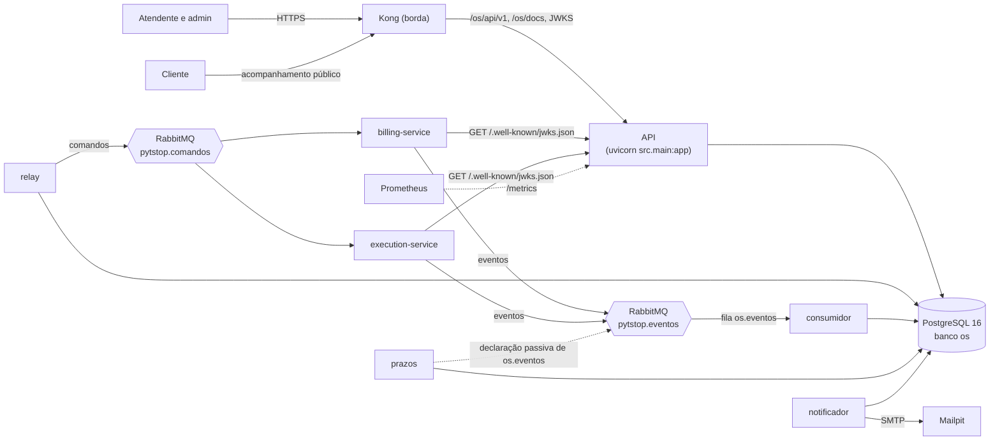

### Processos

Todos saem da mesma imagem e do mesmo código; muda o comando.

| Processo | Comando | O que faz | Fala com |
|---|---|---|---|
| API | `uvicorn src.main:app` (pelo `entrypoint.sh`), porta 8000 | Rotas HTTP, Swagger em `/docs`, `/metrics` e as sondas. Grava OS, saga, comandos na outbox e pedidos de e-mail na mesma transação | PostgreSQL |
| relay | `python -m src.relay` | Publica as linhas pendentes da outbox no exchange `pytstop.comandos`, com confirmação do broker | PostgreSQL, RabbitMQ |
| consumidor | `python -m src.consumidor` | Consome `os.eventos`, uma mensagem por vez, e entrega cada evento ao orquestrador da saga | PostgreSQL, RabbitMQ |
| prazos | `python -m src.prazos` | Reenvia o comando sem resposta, compensa o passo que esgota os reenvios e para a compensação sem resposta | PostgreSQL, RabbitMQ (só a presença do consumidor) |
| notificador | `python -m src.notificador` | Entrega os e-mails da tabela `notificacoes` por SMTP | PostgreSQL, Mailpit |
| migração | Job com `alembic upgrade head` e a semente do admin | Leva o banco à última revisão; os pods esperam por ela no initContainer `python -m src.banco aguardar` | PostgreSQL |

Relay, consumidor, `prazos` e notificador servem o `/metrics` na porta 9100 e informam a saúde por arquivos em `/tmp` (heartbeat e pronto); a API tem liveness em `/api/v1/saude` e readiness em `/api/v1/saude/pronto`. Os manifestos estão em `k8s/` e o compose em `docker-compose.yml` ([README, Implantação](../README.md#implantação)).

## 2. Camadas e módulos

Cada contexto delimitado segue a arquitetura em camadas (onion): `interfaces` → `aplicacao` → `dominio`, com a `infraestrutura` implementando as portas que o domínio e a aplicação declaram. O mapeamento do SQLAlchemy é imperativo: as classes do domínio são dataclasses puras, e as tabelas e os mapeamentos ficam em `*/infraestrutura/mapping.py`.

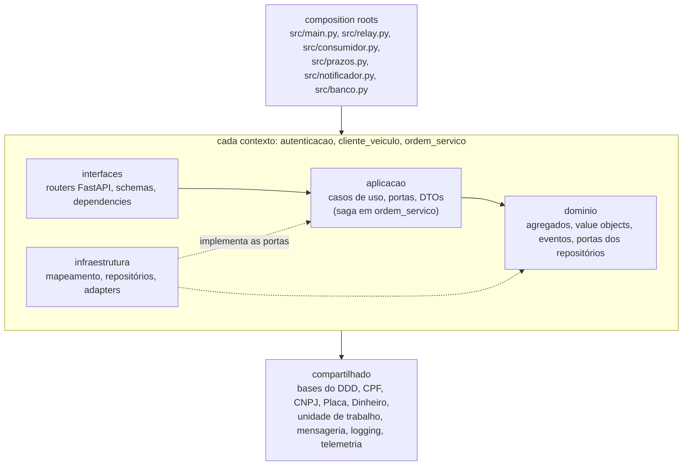

As regras de dependência são contratos do import-linter (`[tool.importlinter]` no `pyproject.toml`, `make lint-arch`, job `lint` do CI):

- camadas `interfaces` → `aplicacao` → `dominio` em cada contexto;
- `dominio` e `aplicacao` de nenhum contexto importam `infraestrutura`, nem `pika`, `jsonschema`, `yaml`, `opentelemetry` ou `prometheus_client`;
- a saga (`ordem_servico/aplicacao/saga/`) não importa o SQLAlchemy, o driver do banco nem a infraestrutura do próprio contexto;
- nada fora das `interfaces` e do `main` importa as `interfaces` (rotas, schemas e dependencies do FastAPI);
- o `dominio` e a `aplicacao` de um contexto não importam o núcleo de outro: a comunicação passa por portas e adapters.

| Contexto | Domínio | Aplicação | Infraestrutura e interfaces |
|---|---|---|---|
| `autenticacao` | `Usuario`, `Papel`, `TokenRevogado` | login, registro, refresh e logout (`use_cases.py`) | `jwt_service.py` (RS256 e JWKS), `password_hasher.py` (bcrypt), `token_revogado_repository.py`; router de `/api/v1/autenticacao` e do JWKS |
| `cliente_veiculo` | `Cliente` (com os `Veiculo`), `ConsentimentoCliente` (agregado próprio), `Contato`, `DocumentoAnonimizado`, `PlacaAnonimizada` | cadastro (`use_cases.py`) e LGPD (`lgpd_use_cases.py`) | repositório com os locks, `adapters.py` (o `OrdemDeServicoSQLAlchemyAdapter` da porta `OrdemDeServicoPort`, com que o cadastro confere as OS do cliente e do veículo e anonimiza o texto livre delas); router de `/api/v1/clientes` |
| `ordem_servico` | `OrdemDeServico`, `MaquinaDeStatus`, `MudancaDeStatus` (histórico), resumos do orçamento e do pagamento, `MarcosDaOrdem`, validação do texto livre | casos de uso da OS, `notificacoes.py` e `emails.py` (e-mail ao cliente), `situacoes.py` e a saga em `aplicacao/saga/` | mapeamento e repositórios, `adapters.py` (o `ClienteSQLAlchemyAdapter` da porta `ClientePort`, com que a abertura lê o cliente e o veículo, e o notificador, o contato), `consultas.py` (query services de leitura), `coletor_da_api.py` e `metrics.py` (métricas), `notificador.py` e `fila_de_notificacoes.py`, `processo_dos_prazos.py` e `transacao_dos_prazos.py`; routers de `/api/v1/ordens-de-servico`, `/api/v1/sagas` e `/api/v1/publico` |
| `compartilhado` | `Entity`, `AggregateRoot`, `ValueObject`, `DomainEvent`, exceções, `CPF`, `CNPJ`, `Placa`, `Dinheiro` | `UnitOfWork` e as portas de mensageria (`Comando`, `Desfecho`, `MensagemRecebida`, `PublicadorDeComandos`) | banco, unidade de trabalho, cifragem, logging com mascaramento de PII, observabilidade e `mensageria/` (AMQP, contratos, outbox, relay, consumidor, processo, telemetria); tratamento de erros, middlewares e sondas |

`compartilhado` é o núcleo técnico, e não um *shared kernel* de negócio: nenhuma regra de negócio cruza contextos por ele. O CPF, o CNPJ e a placa moram nele para o acompanhamento público validar o documento e a placa sem importar o contexto de clientes (`compartilhado/dominio/documento.py`).

**A saga** (`ordem_servico/aplicacao/saga/`) é um *process manager*: estado e regras sem I/O, persistido como o agregado `Saga` na tabela `sagas`.

| Módulo | Papel |
|---|---|
| `saga.py`, `modelo.py`, `leitura_da_saga.py`, `mudanca_da_saga.py` | o agregado (os mutadores, que conferem antes de mudar), as etapas, os motivos e os gatilhos, a leitura do estado e a mecânica que aplica a transição conferida |
| `tabela_da_saga.py`, `transicoes.py` | a tabela do fluxo normal da RFC-004 (seção 4.1) e as conferências que o agregado faz antes de mudar |
| `classificacao.py` | decide se o evento é processado, obsoleto, repetido, adiantado, fora do fluxo ou fora da compensação, antes de tocar no domínio |
| `compensacao.py`, `linhas_da_compensacao.py` | o plano de compensação (função pura) e o tratamento de cada resposta |
| `orquestrador.py`, `linhas_do_fluxo.py`, `resumos_do_billing.py`, `tratamento.py` | traduz cada evento em chamadas (o fato na OS, o comando na outbox e o registro na saga) e devolve o desfecho ao consumidor |
| `contexto_de_envio.py` | o caminho único de envio de comando, com o prazo técnico, o relógio e o span |
| `prazos.py`, `vencer_prazos.py` | reenvio, esgotamento e retomada (funções puras) e o ciclo do processo `prazos` |

`tests/unitarios/ordem_servico/test_limites_do_dominio.py` mede o tamanho que o desenho permite: até 300 linhas por módulo da saga e da `OrdemDeServico`, e até 10 métodos públicos que mudam estado em cada agregado.

## 3. Modelo de dados

PostgreSQL 16, banco `os`, só deste serviço ([ADR-037](https://github.com/fiap-postech-sw-architecture/postech-sw-arch-p4-platform/blob/main/docs/arquitetura/adr/fase4/037-banco-por-servico.md)). O schema nasce das migrações Alembic em `migrations/versions/` (`001` a `005`); da `003` em diante elas só acrescentam, e o rollback da imagem não roda `downgrade`. `tests/integracao/test_migracao.py` compara a migração com o metadata do mapeamento, e `tests/unitarios/test_documentacao.py` compara o metadata com o ER e as tabelas abaixo: coluna nova sem linha aqui reprova o `make test`. O mesmo vale para os estados da OS, as linhas da saga (seção 4.4) e as tabelas da seção 5 que divergirem do código. Status, etapa, origem e situação são `varchar` com os valores dos enums validados pela aplicação, sem tipo nativo nem `CHECK`: um valor novo não pede migração de tipo (`001_schema_inicial.py`).

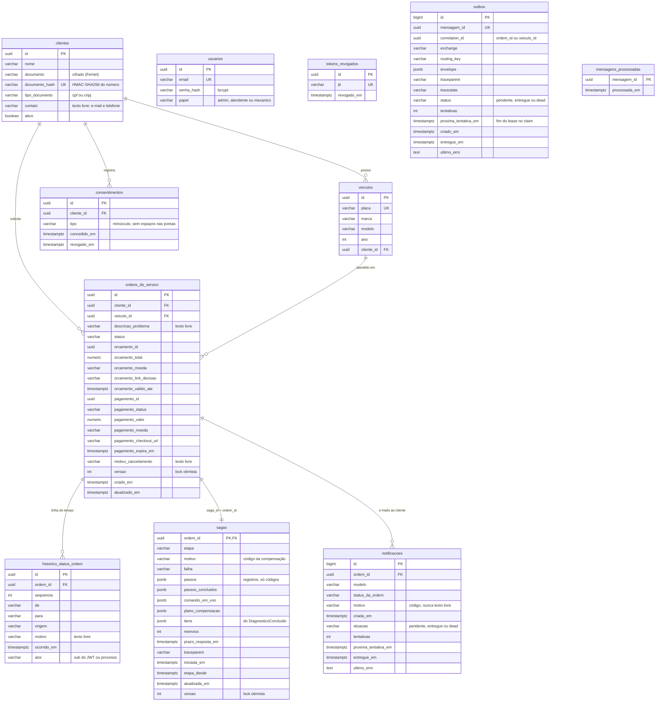

`outbox`, `mensagens_processadas`, `usuarios` e `tokens_revogados` não têm chave estrangeira: a outbox guarda comandos de qualquer agregado (o `AnonimizarVeiculo` leva o `veiculo_id` no `correlation_id`), `mensagens_processadas` guarda ids de mensagens de outros serviços, e o token revogado é só o `jti`.

### Agregado Cliente (contexto `cliente_veiculo`)

`clientes`:

| Coluna | Tipo | Nulo | Chave | Descrição |
|---|---|---|---|---|
| `id` | `uuid` | não | PK | |
| `nome` | `varchar(255)` | não | | `ANONIMIZADO` depois da eliminação |
| `documento` | `varchar(255)` | não | | CPF ou CNPJ cifrado com Fernet (`ENCRYPTION_KEY`); só a API decifra |
| `documento_hash` | `varchar(64)` | não | UNIQUE | HMAC-SHA256 do número do documento: busca e unicidade sem decifrar. A eliminação grava `ANONIMIZADO:<id>`, que preserva a unicidade |
| `tipo_documento` | `varchar(4)` | não | | `cpf` ou `cnpj` |
| `contato` | `varchar(255)` | não | | texto livre; o notificador extrai dele o e-mail |
| `ativo` | `boolean` | não | | `false` depois da desativação ou da eliminação |

`veiculos`, entidade do agregado `Cliente`:

| Coluna | Tipo | Nulo | Chave | Descrição |
|---|---|---|---|---|
| `id` | `uuid` | não | PK | |
| `placa` | `varchar(64)` | não | UNIQUE | formato antigo ou Mercosul, validada pelo VO `Placa`; `ANONIMIZADO:<id>` depois da eliminação |
| `marca`, `modelo` | `varchar(100)` | não | | `ANONIMIZADO` depois da eliminação |
| `ano` | `integer` | não | | de 1887 até o ano seguinte ao atual (`dominio/veiculo.py`) |
| `cliente_id` | `uuid` | não | FK `clientes.id`, índice `ix_veiculos_cliente_id` | |

### Agregado ConsentimentoCliente (contexto `cliente_veiculo`)

`consentimentos`: um agregado próprio, e não filho de `Cliente` (`dominio/consentimento.py`).

| Coluna | Tipo | Nulo | Chave | Descrição |
|---|---|---|---|---|
| `id` | `uuid` | não | PK | |
| `cliente_id` | `uuid` | não | FK `clientes.id` (`ON DELETE CASCADE`) | |
| `tipo` | `varchar(50)` | não | | texto livre normalizado (minúsculo, sem espaços nas pontas): `tratamento_dados`, `marketing`, `compartilhamento`... |
| `concedido_em` | `timestamptz` | não | | |
| `revogado_em` | `timestamptz` | sim | | nulo enquanto ativo; um tipo tem no máximo um consentimento ativo por cliente |

### Agregados Usuario e TokenRevogado (contexto `autenticacao`)

`usuarios`:

| Coluna | Tipo | Nulo | Chave | Descrição |
|---|---|---|---|---|
| `id` | `uuid` | não | PK | o `sub` dos tokens |
| `email` | `varchar(255)` | não | UNIQUE | |
| `senha_hash` | `varchar(255)` | não | | bcrypt (pwdlib) |
| `papel` | `varchar(20)` | não | | `admin`, `atendente` ou `mecanico` |

`tokens_revogados`:

| Coluna | Tipo | Nulo | Chave | Descrição |
|---|---|---|---|---|
| `id` | `uuid` | não | PK | |
| `jti` | `varchar(255)` | não | índice único `ix_tokens_revogados_jti` | o access do logout e cada refresh usado ou revogado |
| `revogado_em` | `timestamptz` | não | | |

O `TokenRevogado` não tem mapeamento ORM: a revogação é um `INSERT ... ON CONFLICT (jti) DO NOTHING`, o que resolve refresh e logout simultâneos sem erro de unicidade (`token_revogado_repository.py`).

### Agregado OrdemDeServico (contexto `ordem_servico`)

`ordens_de_servico`:

| Coluna | Tipo | Nulo | Chave | Descrição |
|---|---|---|---|---|
| `id` | `uuid` | não | PK | também o `saga_id` e o `correlation_id` das mensagens da saga |
| `cliente_id` | `uuid` | não | FK `clientes.id` | |
| `veiculo_id` | `uuid` | não | FK `veiculos.id` | |
| `descricao_problema` | `varchar(1000)` | não | | texto livre validado no domínio; anonimizado pela eliminação |
| `status` | `varchar(30)` | não | índices `(cliente_id, status)` e `(veiculo_id, status)` | um dos nove status, em minúsculas |
| `orcamento_id`, `orcamento_total`, `orcamento_moeda`, `orcamento_link_decisao`, `orcamento_valido_ate` | `uuid`, `numeric(12,2)`, `varchar(3)`, `varchar(2048)`, `timestamptz` | sim | | resumo do orçamento, copiado do `OrcamentoGerado` (um `composite()` do mapeamento) |
| `pagamento_id`, `pagamento_status`, `pagamento_valor`, `pagamento_moeda`, `pagamento_checkout_url`, `pagamento_expira_em` | `uuid`, `varchar(30)`, `numeric(12,2)`, `varchar(3)`, `varchar(2048)`, `timestamptz` | sim | | resumo do pagamento, do `PagamentoSolicitado` em diante; o status é `solicitado`, `confirmado`, `recusado`, `expirado`, `cancelado` ou `estornado` |
| `motivo_cancelamento` | `varchar(500)` | sim | | o texto do pedido de cancelamento, guardado já no 202; volta a nulo se o início da execução vencer o pedido; anonimizado pela eliminação |
| `versao` | `integer` | não | | lock otimista (`version_id_col`): a escrita concorrente vira 409 |
| `criado_em`, `atualizado_em` | `timestamptz` | não | | |

`historico_status_ordem`, entidade do agregado (`MudancaDeStatus`), só recebe inserções, na transação de cada transição:

| Coluna | Tipo | Nulo | Chave | Descrição |
|---|---|---|---|---|
| `id` | `uuid` | não | PK | |
| `ordem_id` | `uuid` | não | FK `ordens_de_servico.id` (`ON DELETE CASCADE`); UNIQUE `(ordem_id, sequencia)` | |
| `sequencia` | `integer` | não | | 1, 2, ... por OS |
| `de`, `para` | `varchar(30)` | `de` sim, `para` não | | `de` é nulo só na abertura |
| `origem` | `varchar(30)` | não | | `atendimento`, `execucao`, `billing` ou `saga` |
| `motivo` | `varchar(500)` | sim | | o motivo do cancelamento; a única coluna que a eliminação reescreve |
| `ocorrido_em` | `timestamptz` | não | índice `ix_historico_status_ordem_ocorrido_em` | a janela de 30 dias das métricas lê por ele |
| `ator` | `varchar(64)` | sim | | o `sub` do JWT ou o processo (`consumidor`); nulo nas linhas anteriores à migração `003` |

Os nove status e as transições que a `MaquinaDeStatus` permite (`dominio/maquina_de_status.py`); entre parênteses, a `origem` gravada no histórico:

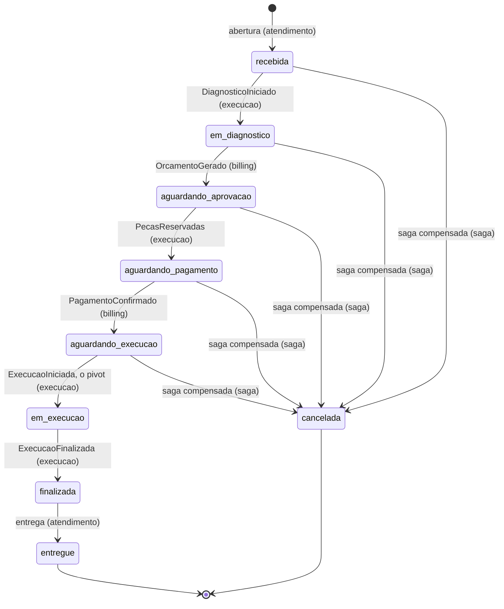

`entregue` e `cancelada` são terminais (`ESTADOS_TERMINAIS`, em `dominio/status.py`): só a OS num deles libera a desativação e a eliminação do cliente.

### Agregado Saga (contexto `ordem_servico`, camada de aplicação)

`sagas`, uma linha por OS:

| Coluna | Tipo | Nulo | Chave | Descrição |
|---|---|---|---|---|
| `ordem_id` | `uuid` | não | PK e FK `ordens_de_servico.id` (`ON DELETE CASCADE`) | |
| `etapa` | `varchar(30)` | não | índice parcial `ix_sagas_ativas (etapa, etapa_desde)` fora de `concluida` e `compensada` | uma das doze etapas, em minúsculas |
| `motivo` | `varchar(30)` | sim | | o código da compensação: `orcamento_recusado`, `orcamento_expirado`, `geracao_falhou`, `reserva_falhou`, `pagamento_recusado`, `pagamento_expirado`, `cancelamento` ou `prazo_tecnico` |
| `falha` | `varchar(30)` | sim | | `reenvios_esgotados` ou `estorno_recusado`, só em `falha_na_compensacao` |
| `passos` | `jsonb` | não | | a linha do tempo: um registro por transição, só com códigos (`seq`, `em`, `de`, `para`, `gatilho`, `mensagem_id`, `comando`, `comando_id`, `motivo`, `ator`, e `posicao_na_fila` ou `reenvio` quando cabem) |
| `passos_concluidos` | `jsonb` | não | | os passos T concluídos, que o plano de compensação desfaz |
| `comando_em_voo` | `jsonb` | sim | | o comando com resposta automática à espera dela: tipo, dados, `enviado_em` e `mensagem_ids` (o id de cada envio; o último é o mais recente) |
| `plano_compensacao` | `jsonb` | não | | as compensações que faltam; a primeira é a pendente |
| `itens` | `jsonb` | não | | os itens do `DiagnosticoConcluido`, de que saem o `GerarOrcamento` e o `ReservarPecas` |
| `reenvios` | `integer` | não | | reenvios do comando em voo; recomeça a cada comando novo |
| `prazo_resposta_em` | `timestamptz` | sim | índice parcial `ix_sagas_prazo`, só com prazo | envio + `SAGA_PRAZO_RESPOSTA_SEGUNDOS`; o limite inferior com que o `prazos` acha as candidatas |
| `traceparent` | `varchar(55)` | sim | | o contexto W3C da última transição, pai dos spans de cancelamento, prazo e retomada |
| `iniciada_em`, `etapa_desde`, `atualizada_em` | `timestamptz` | não | | abertura, entrada na etapa atual e última transição |
| `versao` | `integer` | não | | lock otimista |

As etapas, o status que cada uma mostra e o comando que cada evento dispara estão no [README, Etapas e status](../README.md#etapas-e-status); o diagrama de estados da instância é o da RFC-004, seção 4.1.

### Mensageria e e-mail (contexto `compartilhado` e `ordem_servico`)

`outbox`, os comandos a publicar (gravados no mesmo commit do efeito):

| Coluna | Tipo | Nulo | Chave | Descrição |
|---|---|---|---|---|
| `id` | `bigint` | não | PK (sequência) | a ordem de publicação |
| `mensagem_id` | `uuid` | não | UNIQUE | o `id` do envelope e o `message_id` AMQP |
| `correlation_id` | `uuid` | não | índice `(correlation_id, id, status)` | a OS (o `veiculo_id` no `AnonimizarVeiculo`); a ordem de publicação é por ele |
| `exchange`, `routing_key` | `varchar(64)`, `varchar(255)` | não | | `pytstop.comandos` e `comando.<serviço>.<tipo>` |
| `envelope` | `jsonb` | não | | a mensagem inteira, no formato da RFC-004, seção 5.2 |
| `traceparent`, `tracestate` | `varchar(128)`, `varchar(512)` | sim | | o contexto do span de quem gravou |
| `status` | `varchar(20)` | não | índices `(status, proxima_tentativa_em)`, `(status, entregue_em)` e `(status, criado_em)` | `pendente`, `entregue` ou `dead` |
| `tentativas` | `integer` | não | | falhas da própria linha; a quinta a leva a `dead` |
| `proxima_tentativa_em` | `timestamptz` | não | | quando a linha volta a ser reivindicável; no claim, o fim do lease, que serve de token da réplica |
| `criado_em`, `entregue_em` | `timestamptz` | `entregue_em` sim | | relógio do banco; a limpeza apaga as entregues há 7 dias e as `dead` há 30 |
| `ultimo_erro` | `text` | sim | | texto fixo (o código do broker ou o nome da exceção), nunca a mensagem dela |

`mensagens_processadas`, a idempotência do consumidor (o registro entra no mesmo commit do efeito):

| Coluna | Tipo | Nulo | Chave | Descrição |
|---|---|---|---|---|
| `mensagem_id` | `uuid` | não | PK | o `id` do envelope recebido |
| `processada_em` | `timestamptz` | não | índice `ix_mensagens_processadas_processada_em` | a limpeza apaga as de mais de 30 dias |

`notificacoes`, os e-mails a enviar (migração `004`):

| Coluna | Tipo | Nulo | Chave | Descrição |
|---|---|---|---|---|
| `id` | `bigint` | não | PK | |
| `ordem_id` | `uuid` | não | FK `ordens_de_servico.id` (`ON DELETE CASCADE`), índice `(ordem_id, id, situacao)` | |
| `modelo` | `varchar(20)` | não | | `situacao`, `orcamento`, `pagamento` ou `cancelamento` |
| `status_da_ordem` | `varchar(30)` | não | | o status que pediu o e-mail |
| `motivo` | `varchar(30)` | sim | | o código da compensação, só no `cancelamento` |
| `criada_em` | `timestamptz` | não | | |
| `situacao` | `varchar(20)` | não | índice `(situacao, proxima_tentativa_em)` | `pendente`, `entregue` ou `dead` |
| `tentativas`, `proxima_tentativa_em`, `entregue_em`, `ultimo_erro` | | | | como na outbox |

A linha não guarda endereço, nome, link nem texto livre: o notificador lê o contato do cliente e os links do resumo da OS na hora da entrega.

### Conferência com o ER da RFC-004 (seção 7.2)

O ER da RFC traz só as colunas de que a saga e os contratos dependem. O banco tem também: `nome` e `tipo_documento` em `clientes`; `marca`, `modelo` e `ano` em `veiculos`; `concedido_em` em `consentimentos`; `revogado_em` em `tokens_revogados`; as colunas do resumo do orçamento e do pagamento, `criado_em` e `atualizado_em` em `ordens_de_servico`; e `tentativas`, `proxima_tentativa_em`, `criado_em` e `ultimo_erro` na outbox. `descricao_problema` é `varchar(1000)`, e não `text`. Não há diferença nas colunas que a RFC lista.

## 4. Fluxos passo a passo

Nos diagramas, setas abertas são mensagens assíncronas (outbox, relay, exchange, fila e consumidor) e o Kong, na frente da API, fica omitido.

### 4.1 Autenticação (JWT e JWKS)

1. `POST /api/v1/autenticacao/login` com e-mail e senha. O caso de uso acha o usuário pelo e-mail e confere a senha com bcrypt; e-mail desconhecido e senha errada dão o mesmo 401.
2. A resposta traz o access token (15 minutos) e o refresh (7 dias), assinados com RS256. O `kid` do cabeçalho é a impressão digital da chave pública (RFC 7638), e os claims são `iss`, `aud`, `sub`, `papel` (só no access), `type`, `jti`, `iat` e `exp`.
3. Em cada rota protegida, a API confere a assinatura, o emissor, a audiência, a validade, `type=access`, o `jti` (não revogado, em `tokens_revogados`) e o papel da rota. O `admin` herda o `atendente` e o `mecanico` (`autenticacao/interfaces/middleware.py`).
4. Billing e Execução validam o mesmo token sem chamar o OS a cada requisição: leem o JWKS (`GET /.well-known/jwks.json`, público, com cache de 10 minutos) e conferem localmente.
5. `POST /refresh` troca o refresh por um par novo, uma vez só: o `jti` usado vai para `tokens_revogados`, e a reapresentação dá 401 e o evento de log `refresh_reuse_detected`.
6. `POST /logout` revoga o `jti` do access e, se vier no corpo, o do refresh. A revogação vale só neste serviço; nos outros, o limite é a expiração do access.

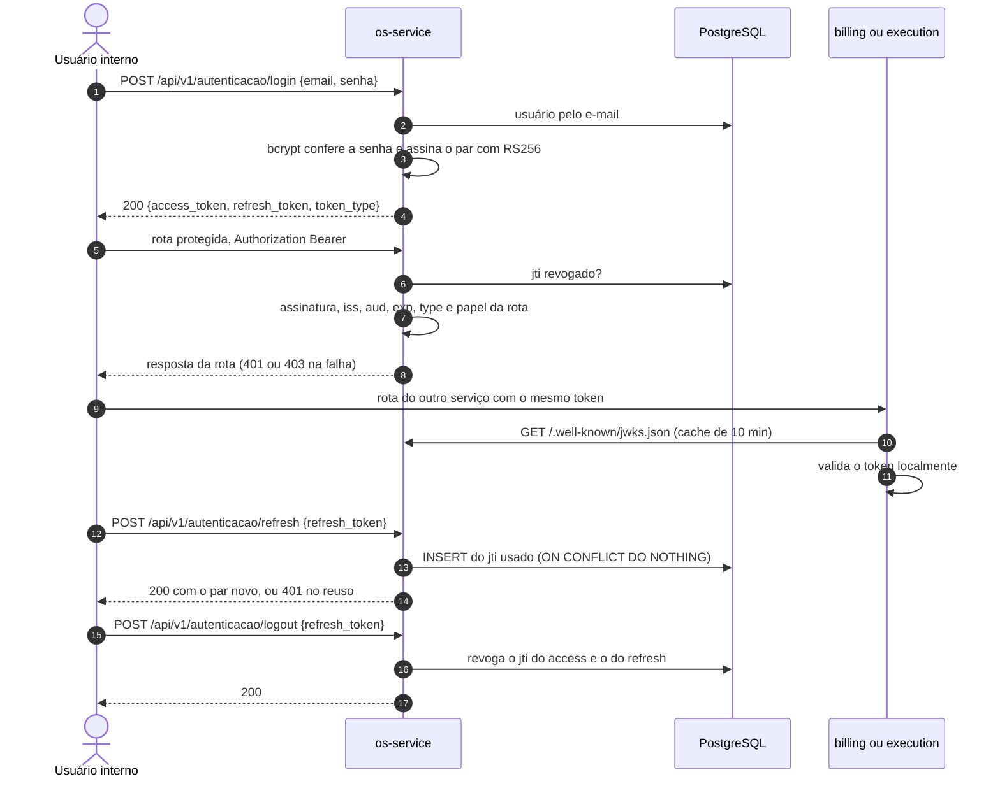

Rotação da chave sem derrubar sessão, variáveis e limites: [README, Autenticação](../README.md#autenticação).

### 4.2 Cadastro com consentimento LGPD

1. `POST /api/v1/clientes` (atendente ou admin). O VO `CPF` ou `CNPJ` confere o dígito verificador antes de qualquer acesso ao banco (documento inválido: 422 `VALOR_INVALIDO`). Documento já cadastrado, achado pelo `documento_hash`, dá 409.
2. O mapeamento cifra o documento com Fernet e grava o HMAC dele. A resposta traz o documento formatado e o mascarado (`***.***.***-25`).
3. `POST /api/v1/clientes/{id}/consentimento` registra um consentimento por tipo; outro ativo do mesmo tipo dá 409. `DELETE .../consentimento?tipo=` o revoga (grava `revogado_em`).
4. `POST /api/v1/clientes/{id}/veiculos` valida a placa pelo VO; placa já cadastrada dá 409.
5. `GET .../dados-pessoais` e `GET .../dados-pessoais/exportar` devolvem os dados do titular decifrados (direito de acesso), com uma linha de auditoria no log sem o dado.
6. O consentimento não é pré-condição da abertura da OS: `AbrirOrdem` confere só o cliente ativo e o veículo dele (`ordem_servico/aplicacao/use_cases.py`).

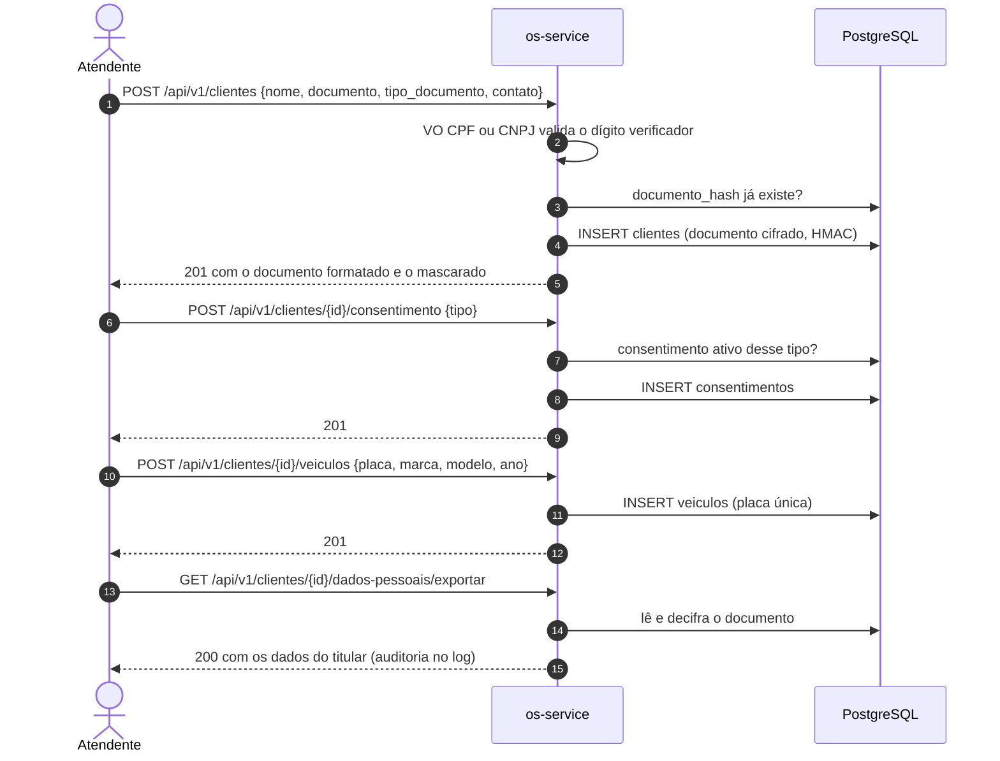

A eliminação dos dados pessoais está em [6. Segurança e LGPD](#6-segurança-e-lgpd).

### 4.3 Abertura e ciclo de status da OS

1. `POST /api/v1/ordens-de-servico` (atendente ou admin) com o cliente, o veículo e a descrição do problema.
2. O caso de uso confere que o cliente está ativo, lendo-o com `FOR SHARE` até o commit (a desativação e a eliminação o travam com `FOR UPDATE`, então as duas operações se excluem), e que o veículo é dele. Cliente inexistente ou inativo dá 404, e veículo inexistente ou de outro cliente também, sem distinguir os dois casos.
3. O domínio valida a descrição (até 1000 caracteres, sem caractere de controle ou de formatação) e abre a OS em `recebida`, com a primeira linha do histórico.
4. Na mesma transação: a OS, o `SolicitarDiagnostico` na outbox (com a placa, a marca, o modelo, o ano e a descrição, que vão só para a Execução) e a saga em `aguardando_diagnostico`, com o registro `abertura` e o `sub` do atendente como ator. Um commit; o 201 sai com a OS e a etapa.
5. Daí em diante, cada status muda por um evento que o consumidor aplica (seção 4.4), menos a entrega: `POST .../entrega` leva a OS de `finalizada` a `entregue` (T10, fora da saga), grava o pedido de e-mail na mesma transação e dá 409 fora de `finalizada`.
6. `GET /api/v1/ordens-de-servico` lista a fila por prioridade de status (a OS em execução primeiro, a recebida por último, a mais antiga antes dentro do status; as encerradas só com `incluir_encerradas=true`), `GET .../{id}` traz o status e a etapa da mesma leitura, e `GET .../{id}/historico` devolve as mudanças de status e os registros da saga em duas listas.

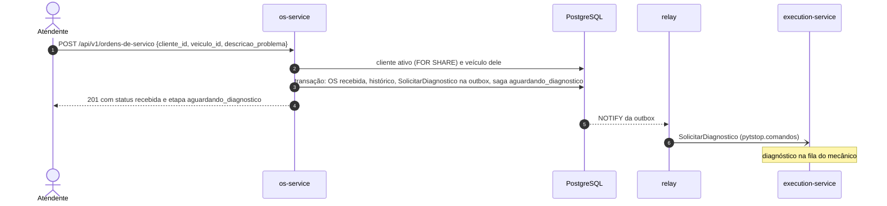

### 4.4 A saga de ponta a ponta

Cada evento chega pela fila `os.eventos` e é tratado numa transação do consumidor: o fato na OS (status e histórico, ou o resumo do Billing), o registro na saga, o comando seguinte na outbox, o pedido de e-mail quando o status muda e o `id` da mensagem em `mensagens_processadas`, num commit só, e só então o `ack`.

| Passo | Evento recebido | Efeito na OS | Etapa da saga depois | Comando enviado |
|---|---|---|---|---|
| T1 | (requisição de abertura) | `recebida` | `aguardando_diagnostico` | `SolicitarDiagnostico` |
| T2 | `DiagnosticoIniciado` | `em_diagnostico` | `aguardando_diagnostico` | nenhum |
| T2 | `DiagnosticoConcluido` | nenhum (a saga guarda os itens) | `aguardando_orcamento` | `GerarOrcamento` |
| T3 | `OrcamentoGerado` | resumo do orçamento, `aguardando_aprovacao`, e-mail com o link de decisão | `aguardando_decisao` | nenhum |
| T4 | `OrcamentoAprovado` | nenhum | `aguardando_reserva` | `ReservarPecas` |
| T5 | `PecasReservadas` | `aguardando_pagamento` | `aguardando_pagamento` | `SolicitarPagamento` |
| T6 | `PagamentoSolicitado` | resumo do pagamento, e-mail com o checkout | `aguardando_pagamento` | nenhum |
| T6 | `PagamentoConfirmado` | `aguardando_execucao` | `aguardando_agendamento` | `AgendarExecucao` |
| T7 | `ExecucaoAgendada` | nenhum (a posição na fila fica no registro) | `aguardando_inicio` | nenhum |
| T8 | `ExecucaoIniciada` (pivot) | `em_execucao` | `em_execucao` | nenhum |
| T9 | `ExecucaoFinalizada` | `finalizada` | `concluida` | nenhum |
| T10 | (requisição de entrega) | `entregue` | `concluida` | nenhum |

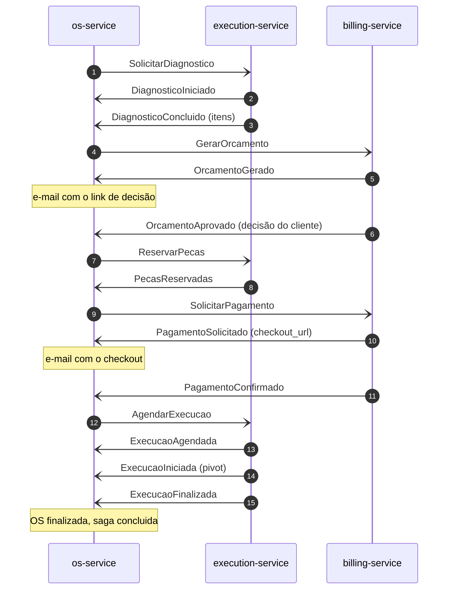

Antes de tocar no domínio, o orquestrador classifica o evento pela etapa (RFC-004, seção 4.5):

- o de etapa já passada, o repetido e o de saga encerrada são ignorados com log;
- o adiantado (`ExecucaoIniciada` antes do `ExecucaoAgendada`) volta pela fila de retry até a saga alcançá-lo;
- o que não tem como ser aplicado (OS sem saga, `ordem_id` divergente, OS encerrada com a saga viva, transição recusada) vai para a DLQ com o motivo em código.

A tabela completa está no [README, Evento fora de ordem](../README.md#evento-fora-de-ordem), e o diagrama com os atores humanos e o Mercado Pago no [README, Caminho feliz](../README.md#caminho-feliz).

O comando com resposta automática (`GerarOrcamento`, `ReservarPecas`, `SolicitarPagamento` até o `PagamentoSolicitado`, `AgendarExecucao` e as cinco compensações) fica na saga como comando em voo, com o prazo técnico e o id de cada envio; a resposta casa com ele pelo `causation_id`.

### 4.5 Compensações por falha de negócio

1. Uma falha de negócio chega na etapa do passo que falhou: `GeracaoDeOrcamentoFalhou`, `OrcamentoRecusado`, `OrcamentoExpirado`, `ReservaDePecasFalhou`, `PagamentoRecusado` ou `PagamentoExpirado`.
2. O plano sai de uma função pura (`aplicacao/saga/compensacao.py`): a compensação de cada passo concluído ou em voo, na ordem fixa `CancelarExecucao`, `EstornarPagamento`, `LiberarReserva`, `CancelarOrcamento` e `DescartarDiagnostico`, menos o que a falha já encerrou no participante. O `DescartarDiagnostico` entra sempre.
3. A saga entra em `compensando` com o motivo em código, e a primeira compensação sai no mesmo commit. O status da OS não muda enquanto a compensação anda.
4. Cada compensação espera a resposta casada da anterior, com prazo técnico. A resposta da última leva a saga a `compensada` e a OS a `cancelada`, com origem `saga`, o rótulo do motivo no histórico e o e-mail de cancelamento.

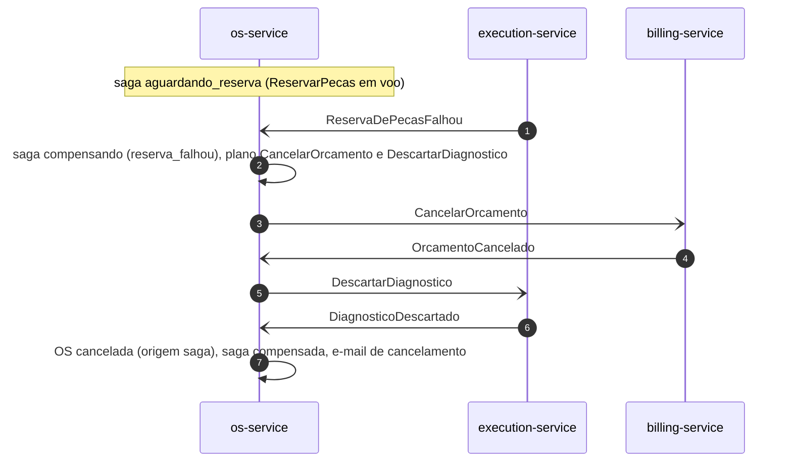

As onze linhas do plano por etapa e gatilho, os eventos que chegam durante a compensação e o estorno automático do Billing estão no [README, Compensações e cancelamento](../README.md#compensações-e-cancelamento).

### 4.6 Cancelamento pedido pelo atendente

1. `POST /api/v1/ordens-de-servico/{id}/cancelamento` com o motivo (texto livre, até 500 caracteres).
2. Antes do pivot (etapas `aguardando_*`): a OS guarda o texto em `motivo_cancelamento` sem mudar o status, a saga entra em `compensando` com o motivo `cancelamento` e o plano da etapa, e a primeira compensação sai no mesmo commit, com o registro `cancelamento_solicitado`. Resposta 202 com a etapa `compensando`.
3. Com a compensação já em curso ou parada, o pedido repetido responde 202 sem efeito. Depois do pivot responde 409 ("Cancelamento recusado: execução já iniciada"), e com a OS já cancelada, 409 ("Ordem já cancelada").
4. Se o consumidor grava a mesma OS ou saga no meio, a requisição relê as duas e decide de novo, até três leituras, antes do 409 `CONFLITO_DE_CONCORRENCIA`.
5. A corrida do pivot: se o `ExecucaoIniciada` chega com só o `CancelarExecucao` pendente, a saga e a OS voltam a `em_execucao`, o texto do pedido é descartado e o registro leva o gatilho `cancelamento_recusado`.
6. Cada pedido deixa uma linha de auditoria com o `correlation_id`, o `ator` e o resultado, nunca o texto do motivo; o texto só fica na OS e, depois do cancelamento, no histórico, onde a eliminação LGPD o alcança.

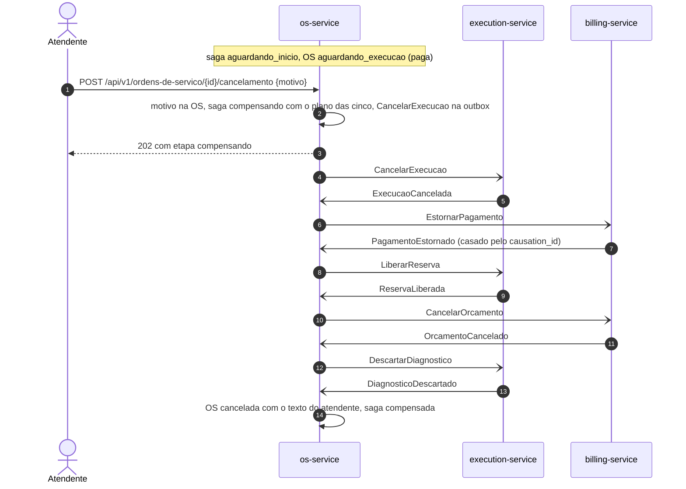

As respostas por etapa estão no [README, Compensações e cancelamento](../README.md#compensações-e-cancelamento).

### 4.7 Prazos técnicos e reenvio

O processo `prazos` roda a cada `PRAZOS_INTERVALO_SEGUNDOS` (30 por padrão), uma transação por saga:

1. Confere o relógio do processo contra o `clock_timestamp()` do banco; com desvio acima de 5 s, o ciclo não age.
2. Reivindica a saga de prazo vencido mais antiga com `FOR UPDATE SKIP LOCKED`: duas réplicas nunca pegam a mesma.
3. O prazo só corre depois que o comando sai da outbox: a saga vence só se a linha do envio mais recente está `entregue` há mais de `SAGA_PRAZO_RESPOSTA_SEGUNDOS` (120 por padrão).
4. Antes de agir, confere a fila do consumidor por declaração passiva de `os.eventos`: sem consumidor, com mensagem pronta na fila ou com o broker fora, desfaz a transação e não reenvia (a resposta pode estar esperando na fila).
5. Com reenvios disponíveis, reenvia o mesmo comando (os mesmos dados, `id` novo, sem `causation_id`), soma um a `reenvios`, grava o prazo novo e o registro `reenvio`.
6. Esgotados os `SAGA_MAX_REENVIOS` (5 por padrão) numa etapa do fluxo, inicia a compensação com o motivo `prazo_tecnico` e o passo em voo no plano. Numa compensação, leva a saga a `falha_na_compensacao` (seção 4.8).

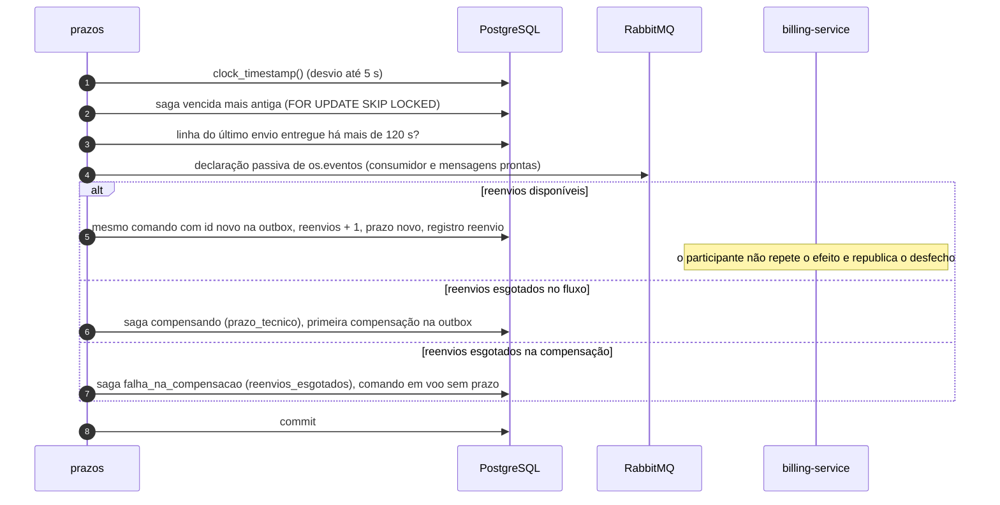

Com os padrões, o original e os cinco reenvios dão ao participante 12 minutos, mais que os 381 s da escada de retry do consumidor (`tests/unitarios/test_configuracao_dos_prazos.py` confere a relação). Detalhes e limites: [README, Prazos, falha na compensação e retomada](../README.md#prazos-falha-na-compensação-e-retomada).

### 4.8 Falha na compensação e retomada

1. A compensação para em `falha_na_compensacao` com o `EstornoDePagamentoFalhou` casado (`falha=estorno_recusado`) ou com os reenvios esgotados (`falha=reenvios_esgotados`). O que já foi compensado fica compensado, o resto fica como estava, a OS mantém o status e o comando em voo fica sem prazo, com os ids de todos os envios.
2. O alerta "Saga parada" dispara; o operador segue o [runbook da saga](https://github.com/fiap-postech-sw-architecture/postech-sw-arch-p4-platform/blob/main/docs/operacao/runbook-saga.md), consulta `GET /api/v1/sagas/{ordem_id}` e resolve a causa (no estorno recusado, o estorno pelo painel do provedor).
3. `POST /api/v1/sagas/{ordem_id}/compensacao` (admin) reenvia a compensação pendente com `id` novo, zera os reenvios, grava o prazo novo, limpa a falha, volta a saga a `compensando` com o registro `retomada` e segue o plano até `compensada`. Fora de `falha_na_compensacao` responde 409.

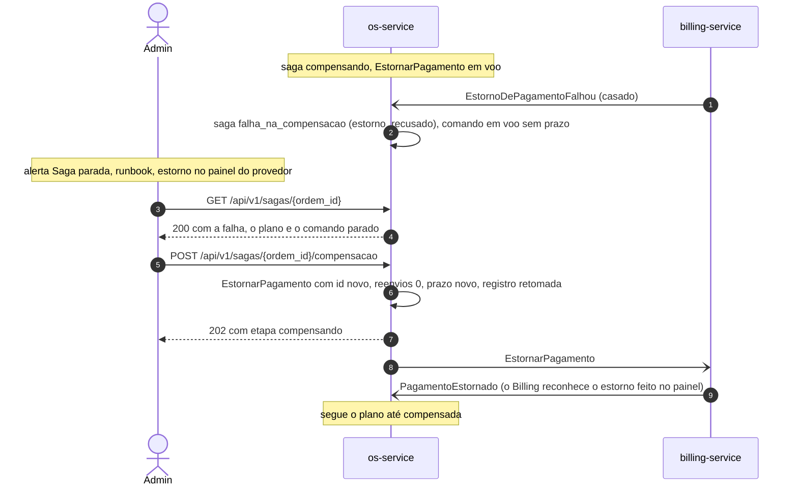

### 4.9 Notificação por e-mail

1. Toda transição de status passa por `registrar_transicao` (`aplicacao/notificacoes.py`), que compara o status de antes com o de depois e grava o pedido do modelo do novo status em `notificacoes`, na mesma transação: `situacao` (`em_diagnostico`, `aguardando_execucao`, `em_execucao`, `finalizada`, `entregue`), `orcamento` (`aguardando_aprovacao`) e `cancelamento` (`cancelada`). O `PagamentoSolicitado`, que não muda o status, pede o modelo `pagamento`. A abertura e `aguardando_pagamento` não pedem e-mail.
2. O `notificador` acorda com o `NOTIFY` da tabela (e por segurança a cada poll) e reivindica uma linha com o mesmo claim da outbox: `FOR UPDATE SKIP LOCKED`, lease com fencing e a ordem por OS.
3. Numa transação de leitura que fecha antes do envio, lê a OS e o contato do cliente por uma projeção de duas colunas (sem carregar o agregado nem decifrar o documento, e por isso sem a `ENCRYPTION_KEY`).
4. Envia por SMTP com prazo de 5 s por operação. A falha conta tentativa e volta depois de 1, 4, 16 e 64 s; a quinta deixa a linha `dead`. Cliente anonimizado, contato sem e-mail ou modelo sem o resumo que pede: a linha fecha sem envio, com aviso no log.

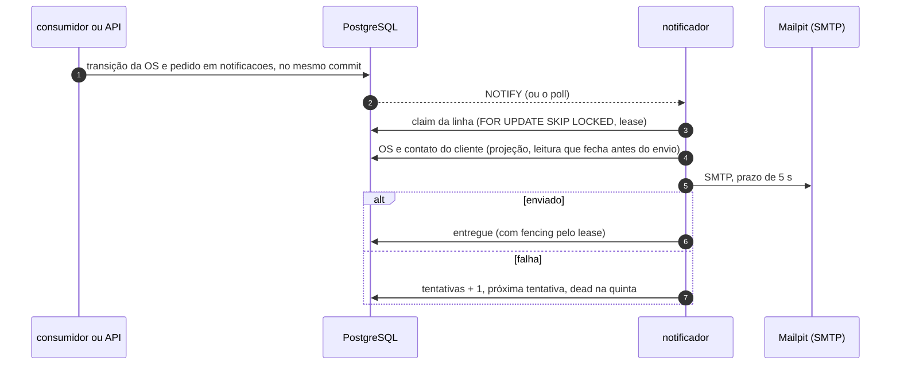

O texto de cada modelo e a operação da linha `dead` estão no [README, Notificações por e-mail e LGPD](../README.md#notificações-por-e-mail-e-lgpd).

### 4.10 Acompanhamento público

1. `POST /api/v1/publico/acompanhamento`, sem token, com a placa e o documento no corpo (nunca na URL, que vai para logs de borda e histórico do navegador), limitado a 10 chamadas por minuto por IP.
2. O schema da rota confere o tamanho: placa com 7 ou 8 caracteres e documento com 11 a 18. Fora disso (e com campo faltando ou a mais), a resposta é o 422 da validação de schema, sem consulta.
3. Dentro desses tamanhos, o VO `Placa` e o VO `CPF` ou `CNPJ` validam o formato e o dígito verificador antes de qualquer acesso ao banco. A entrada inválida devolve o mesmo 404 da OS não encontrada, sem consulta: quem tenta não distingue documento inválido de documento inexistente, nem do documento de outro dono.
4. Um query service (a porta `ConsultaAcompanhamento`, implementada em `infraestrutura/consultas.py`) projeta só o status e os instantes da OS mais recente do par placa e documento, sem nada do cliente. Sem OS para o par (placa ou documento inexistente, ou de donos diferentes), a resposta é o mesmo 404.

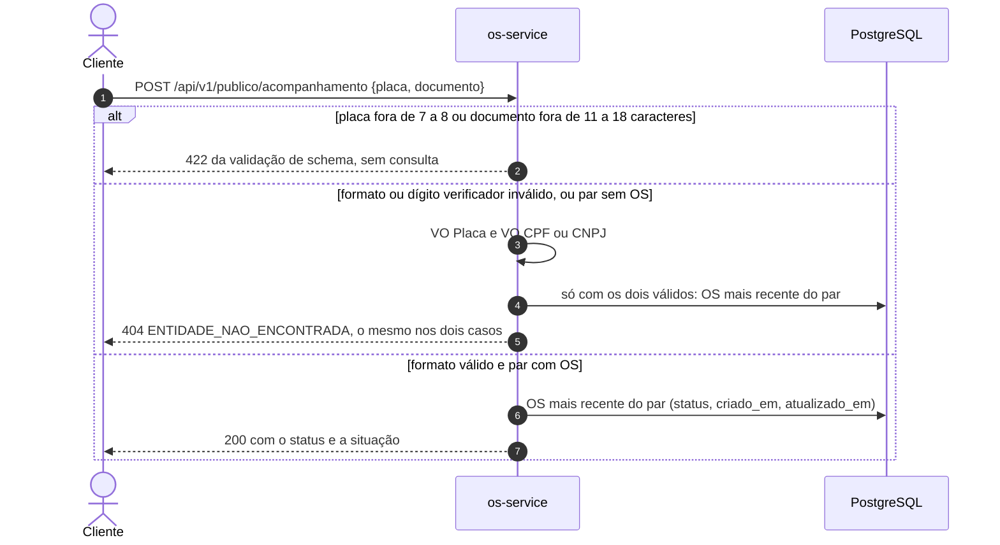

### 4.11 Outbox, relay e consumidor

1. O caso de uso grava o comando na outbox pela unidade de trabalho, no mesmo commit do efeito, no envelope do contrato (validado na hora: comando fora do contrato é defeito e sobe como 500), com o contexto W3C do span corrente.
2. O relay acorda com o `NOTIFY` da outbox e, por segurança, a cada `OUTBOX_POLL_SEGUNDOS`. Reivindica um lote com `FOR UPDATE SKIP LOCKED` e um lease, na ordem de cada OS, e publica fora de transação, com *publisher confirms* e `mandatory`. A linha só vira `entregue` depois da confirmação; quem perdeu o lease não grava o desfecho por cima.
3. O consumidor lê `os.eventos` com prefetch 1 e ack manual: confere a origem (o `user_id` que o broker garante), o tamanho, o contrato e os ids do envelope; grava o `id` em `mensagens_processadas` e chama o handler do tipo com a transação da mensagem; comita uma vez e só então dá `ack`.
4. Erro transitório (banco fora, evento adiantado, conflito de versão) vai para a fila de retry do nível (1, 5, 15, 60 e 300 s); a sexta falha, o erro permanente e a exceção do handler vão para `os.eventos.dlq`. O id repetido recebe `ack` sem efeito.

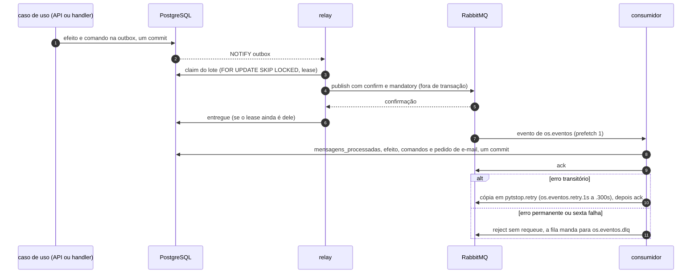

O comportamento com o broker fora, com alarme de memória e o encerramento estão no [README, Mensageria](../README.md#mensageria).

## 5. Mensageria

A topologia, o envelope, o catálogo de comandos e eventos e as garantias de entrega são da RFC-004, seções [4](https://github.com/fiap-postech-sw-architecture/postech-sw-arch-p4-platform/blob/main/docs/arquitetura/rfc/fase4/rfc-004-microsservicos-saga.md#4-saga-de-atendimento) e [5](https://github.com/fiap-postech-sw-architecture/postech-sw-arch-p4-platform/blob/main/docs/arquitetura/rfc/fase4/rfc-004-microsservicos-saga.md#5-mensageria), e do [ADR-036](https://github.com/fiap-postech-sw-architecture/postech-sw-arch-p4-platform/blob/main/docs/arquitetura/adr/fase4/036-mensageria-rabbitmq.md). As filas, os exchanges, os argumentos e as permissões estão no [README do platform](https://github.com/fiap-postech-sw-architecture/postech-sw-arch-p4-platform#filas-exchanges-e-argumentos).

As duas tabelas abaixo são o que este serviço publica e consome. Elas repetem o catálogo que o serviço lê de `contratos/asyncapi.yaml` e a etapa esperada de cada evento (`ETAPA_ESPERADA`, em `aplicacao/saga/tabela_da_saga.py`): `tests/unitarios/test_documentacao.py` as compara com o código, e uma mensagem nova sem linha aqui reprova o `make test`.

### Comandos publicados

Onze comandos (enum `Comando`), no exchange `pytstop.comandos` e com o usuário AMQP `os`: os dez da saga e o `AnonimizarVeiculo` da eliminação LGPD, fora dela. As compensações saem na ordem da tabela, só as dos passos concluídos ou em voo (seção 4.5).

| Comando | Routing key | Quando sai |
|---|---|---|
| `SolicitarDiagnostico` | `comando.execucao.solicitar_diagnostico` | na abertura da OS (T1), sem prazo técnico |
| `GerarOrcamento` | `comando.billing.gerar_orcamento` | com o `DiagnosticoConcluido` |
| `ReservarPecas` | `comando.execucao.reservar_pecas` | com o `OrcamentoAprovado` |
| `SolicitarPagamento` | `comando.billing.solicitar_pagamento` | com o `PecasReservadas` |
| `AgendarExecucao` | `comando.execucao.agendar_execucao` | com o `PagamentoConfirmado`, prioridade `normal` |
| `CancelarExecucao` | `comando.execucao.cancelar_execucao` | compensação do agendamento (T7) |
| `EstornarPagamento` | `comando.billing.estornar_pagamento` | compensação do pagamento (T6) |
| `LiberarReserva` | `comando.execucao.liberar_reserva` | compensação da reserva (T5) |
| `CancelarOrcamento` | `comando.billing.cancelar_orcamento` | compensação do orçamento (T3) |
| `DescartarDiagnostico` | `comando.execucao.descartar_diagnostico` | compensação do diagnóstico (T2), sempre a última do plano |
| `AnonimizarVeiculo` | `comando.execucao.anonimizar_veiculo` | na eliminação LGPD, um por veículo que ainda guarda a placa, com o `veiculo_id` no `correlation_id` |

### Eventos consumidos

Vinte e três eventos da fila `os.eventos`, 13 do Billing e 10 da Execução, todos entregues ao orquestrador pelo despachante de `src/consumidor.py`. O consumidor confere quem publicou pelo `user_id` que o broker garante (a coluna "Publica"). A saga confere a etapa: o evento fora da etapa esperada é classificado como na seção 4.4 (ignorado, de volta pela fila de retry ou para a DLQ). As respostas de compensação casam com o comando em voo pelo `causation_id` e mandam a próxima compensação do plano, ou, depois da última, levam a OS a `cancelada`. Os eventos internos da OS (abertura e mudança de status) ficam no histórico e não vão para o broker.

| Evento | Publica | Etapa esperada | Efeito |
|---|---|---|---|
| `DiagnosticoIniciado` | `execucao` | `aguardando_diagnostico` | a OS vai a `em_diagnostico` |
| `DiagnosticoConcluido` | `execucao` | `aguardando_diagnostico` | a saga guarda os itens e manda o `GerarOrcamento` |
| `OrcamentoGerado` | `billing` | `aguardando_orcamento` | resumo do orçamento, a OS em `aguardando_aprovacao` e o e-mail com o link de decisão |
| `GeracaoDeOrcamentoFalhou` | `billing` | `aguardando_orcamento` | falha de negócio: compensa com o motivo `geracao_falhou` |
| `OrcamentoAprovado` | `billing` | `aguardando_decisao` | manda o `ReservarPecas` |
| `OrcamentoRecusado` | `billing` | `aguardando_decisao` | falha de negócio: `orcamento_recusado` |
| `OrcamentoExpirado` | `billing` | `aguardando_decisao` | falha de negócio: `orcamento_expirado` |
| `PecasReservadas` | `execucao` | `aguardando_reserva` | a OS em `aguardando_pagamento` e o `SolicitarPagamento` |
| `ReservaDePecasFalhou` | `execucao` | `aguardando_reserva` | falha de negócio: `reserva_falhou` |
| `PagamentoSolicitado` | `billing` | `aguardando_pagamento` | resumo do pagamento e o e-mail com o checkout |
| `PagamentoConfirmado` | `billing` | `aguardando_pagamento` | a OS em `aguardando_execucao` e o `AgendarExecucao` |
| `PagamentoRecusado` | `billing` | `aguardando_pagamento` | falha de negócio: `pagamento_recusado` |
| `PagamentoExpirado` | `billing` | `aguardando_pagamento` | falha de negócio: `pagamento_expirado` |
| `ExecucaoAgendada` | `execucao` | `aguardando_agendamento` | a posição na fila fica no registro da saga |
| `ExecucaoIniciada` | `execucao` | `aguardando_inicio` | o pivot: a OS em `em_execucao`, e o cancelamento passa a responder 409 |
| `ExecucaoFinalizada` | `execucao` | `em_execucao` | a OS `finalizada` e a saga `concluida` |
| `ExecucaoCancelada` | `execucao` | `compensando` | resposta ao `CancelarExecucao` |
| `PagamentoCancelado` | `billing` | `compensando` | resposta ao `EstornarPagamento` com o pagamento só solicitado: o Billing cancela a cobrança |
| `PagamentoEstornado` | `billing` | `compensando` | resposta ao `EstornarPagamento` com o pagamento confirmado; o estorno automático (`pagamento_apos_encerramento`) chega em qualquer etapa e só muda o resumo do pagamento |
| `EstornoDePagamentoFalhou` | `billing` | `compensando` | resposta ao `EstornarPagamento` recusada pelo provedor: a saga para em `falha_na_compensacao` (seção 4.8) |
| `ReservaLiberada` | `execucao` | `compensando` | resposta ao `LiberarReserva` |
| `OrcamentoCancelado` | `billing` | `compensando` | resposta ao `CancelarOrcamento` |
| `DiagnosticoDescartado` | `execucao` | `compensando` | resposta ao `DescartarDiagnostico` |

### Contratos e garantias

- **Contratos.** `contratos/` é cópia do platform no commit de `contratos/ORIGEM` (AsyncAPI, um JSON Schema por mensagem, exemplos e a topologia do broker). O catálogo e a validação saem do `asyncapi.yaml` em tempo de execução, e o erro de validação aponta o caminho e a regra, nunca o valor.
- **Garantias.** Entrega pelo menos uma vez, com o consumidor idempotente pela chave primária de `mensagens_processadas`; outbox na transação do efeito; retry por atraso com uma fila por nível (o TTL é da fila, porque a mensagem só expira na cabeça dela) e DLQ com 7 dias de retenção. O redrive da DLQ é `make redrive` do platform, depois de implantar a versão que trata a mensagem em todas as réplicas.

## 6. Segurança e LGPD

**Autenticação e autorização** ([ADR-039](https://github.com/fiap-postech-sw-architecture/postech-sw-arch-p4-platform/blob/main/docs/arquitetura/adr/fase4/039-autenticacao-entre-servicos.md)): JWT RS256 com chave de 2048 bits ou mais e JWKS público; fora de `development` e `test`, o boot recusa a chave de demonstração, a ausente e a fraca. Toda falha de credencial responde 401 `NAO_AUTENTICADO` com a mesma mensagem, e o motivo fica só no log; papel válido sem permissão responde 403 `ACESSO_NEGADO`.

| Rotas | Papel |
|---|---|
| `POST /api/v1/autenticacao/login` e `/refresh`, `GET /.well-known/jwks.json`, `POST /api/v1/publico/acompanhamento`, sondas | sem token |
| `POST /api/v1/autenticacao/logout` | qualquer access válido |
| `POST /api/v1/autenticacao/registrar`, `DELETE /api/v1/clientes/{id}/dados-pessoais`, `GET /api/v1/ordens-de-servico/metricas`, `/api/v1/sagas/*` | `admin` |
| demais rotas de `/api/v1/clientes` e de `/api/v1/ordens-de-servico` | `atendente` (o `admin` herda) |

O `mecanico` não tem rota de negócio no OS: trabalha pelas filas da Execução. O SlowAPI limita por IP as rotas sem token e as de credencial (login e registro a 5 por minuto, refresh e logout a 10, JWKS a 60 e o acompanhamento a 10); o resto é limitado na borda pelo Kong ([ADR-038](https://github.com/fiap-postech-sw-architecture/postech-sw-arch-p4-platform/blob/main/docs/arquitetura/adr/fase4/038-borda-e-comunicacao-sincrona.md)).

**Dados pessoais.**

- O documento fica cifrado (Fernet com a `ENCRYPTION_KEY`, que só a API recebe), com um HMAC-SHA256 para busca e unicidade. A API o devolve decifrado ao atendente e ao admin conforme a rota:
  - a listagem (`GET /api/v1/clientes`) traz só o mascarado (`documento_mascarado`, `***.***.***-25`);
  - o cadastro, a consulta e a atualização (`POST /api/v1/clientes`, `GET` e `PUT /api/v1/clientes/{id}`) trazem o documento inteiro, formatado (`documento_formatado`), e o mascarado;
  - `GET .../dados-pessoais` e `GET .../dados-pessoais/exportar` trazem o formatado, com a linha de auditoria no log.
- Texto livre (descrição do problema e motivo do cancelamento) é validado no domínio: recusa caracteres de controle e de formatação que escondem ou reordenam o texto lido na tela (`dominio/texto_livre.py`).
- A saga, a outbox de e-mail, as métricas e os spans guardam só códigos; a placa e a descrição vão só no `SolicitarDiagnostico`, para a Execução.
- Os logs passam por um mascaramento de CPF, CNPJ, e-mail, telefone e chaves sensíveis (`compartilhado/infraestrutura/logging.py`), inclusive o traceback e o log das bibliotecas; os spans não levam o texto das exceções nem o caminho cru da URL ([7. Observabilidade](#7-observabilidade)).

**Eliminação de dados** (`DELETE /api/v1/clientes/{id}/dados-pessoais`, admin):

1. Trava o cliente com `FOR UPDATE` e só então confere que ele não tem OS ativa (a abertura de OS lê o cliente com `FOR SHARE`, então não há janela entre a conferência e a escrita). Com OS ativa, 409: a OS em andamento é o contrato em execução.
2. Numa transação: anonimiza o cliente (nome, documento, hash, contato, `ativo=false`), os veículos (placa, marca e modelo), o texto livre das OS (descrição, motivo do cancelamento e o motivo do histórico) e, na outbox, a placa e a descrição dos `SolicitarDiagnostico` do cliente, em qualquer situação da linha.
3. Grava um `AnonimizarVeiculo` por veículo que ainda guarda a placa original, para a Execução apagar a dela. Se a transação desfaz, nenhum comando sai e nada é anonimizado; repetida, a eliminação responde 204 sem reenviar o comando.

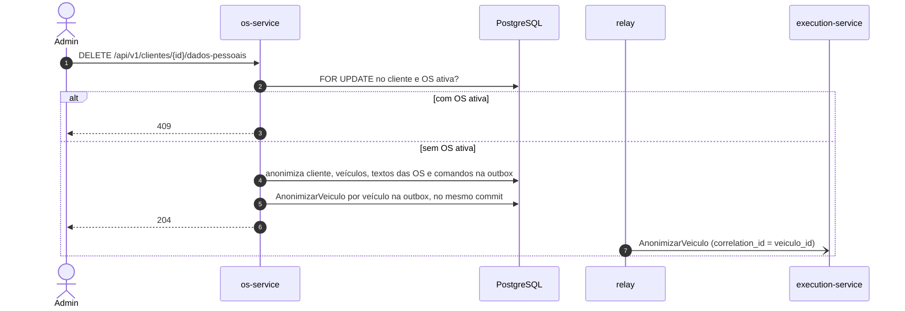

Depois de uma eliminação não se faz redrive de DLQ de comando, que recriaria a placa na Execução; o reenvio de um `AnonimizarVeiculo` que caiu na DLQ é `scripts/reenviar_anonimizacao.py` ([README, Eliminação de dados](../README.md#eliminação-de-dados-lgpd)).

**Infraestrutura** ([README, Implantação](../README.md#implantação)):

- pods sem root, raiz somente leitura, sem token de ServiceAccount e com seccomp `RuntimeDefault`;
- NetworkPolicy que nega toda entrada no namespace e libera só o necessário, e restringe a saída do notificador ao DNS, ao PostgreSQL e ao Mailpit;
- papéis do banco separados para a migração (`os`, dono do schema) e para os processos (`os_app`, só DML, que lê a `alembic_version` sem escrevê-la);
- nenhum segredo nos manifestos.

## 7. Observabilidade

Métricas, traces e logs seguem o [ADR-043](https://github.com/fiap-postech-sw-architecture/postech-sw-arch-p4-platform/blob/main/docs/arquitetura/adr/fase4/043-observabilidade-distribuida.md); o catálogo das métricas dos três serviços, os painéis e os alertas estão no [README de observabilidade do platform](https://github.com/fiap-postech-sw-architecture/postech-sw-arch-p4-platform/blob/main/observabilidade/README.md#catálogo-de-métricas).

- **Métricas.** Cada processo serve o `/metrics` (a API na porta 8000, fora da borda; os demais na 9100). Contadores da saga e da OS criada contam depois do commit da transação raiz; os gauges por consulta (sagas ativas, etapa mais antiga, prazo vencido, idade da outbox, OS por status e permanência média) saem de um coletor da API, com conexão e prazos próprios, e ficam ausentes, nunca zerados, quando a leitura falha.
- **Traces.** A requisição de abertura é a raiz do trace da saga: a outbox guarda o contexto, o relay publica como filho, o consumidor abre o span de consumo como filho da publicação, e cancelamento, prazo e retomada abrem spans filhos do contexto que a saga guarda. O `correlation_id` (o id da OS) vai no atributo `messaging.message.conversation_id`.
- **Logs.** JSON com `correlation_id`, `trace_id` e `span_id`, sem dado pessoal nem texto livre. O `event` vem em inglês, menos os nomes herdados da fase 3: as auditorias LGPD (como `dados_pessoais_exportados_via_admin`) e os do tratamento de erros (como `erro_interno`). Também saem em português as duas mensagens da criptografia (`compartilhado/infraestrutura/encryption.py`: chave não configurada e falha ao decifrar um token), que usam o `logging` da stdlib.

A tabela das séries, o que não é exportado e por quê, e como ver localmente e no kind estão no [README, Observabilidade](../README.md#observabilidade).

## 8. Decisões

| Decisão | Onde |
|---|---|
| Três serviços, e o OS dono da OS, de clientes e veículos, dos usuários e da saga | [ADR-034](https://github.com/fiap-postech-sw-architecture/postech-sw-arch-p4-platform/blob/main/docs/arquitetura/adr/fase4/034-decomposicao-em-microsservicos.md) |
| Saga orquestrada, com o orquestrador no serviço que a inicia e persistido como agregado na mesma transação da OS | [ADR-035](https://github.com/fiap-postech-sw-architecture/postech-sw-arch-p4-platform/blob/main/docs/arquitetura/adr/fase4/035-saga-orquestrada.md), `aplicacao/saga/` |
| RabbitMQ com outbox transacional, consumidor idempotente, retry por atraso e DLQ | [ADR-036](https://github.com/fiap-postech-sw-architecture/postech-sw-arch-p4-platform/blob/main/docs/arquitetura/adr/fase4/036-mensageria-rabbitmq.md), `compartilhado/infraestrutura/mensageria/` |
| Banco próprio (PostgreSQL 16) com credencial só nos pods do serviço | [ADR-037](https://github.com/fiap-postech-sw-architecture/postech-sw-arch-p4-platform/blob/main/docs/arquitetura/adr/fase4/037-banco-por-servico.md), `k8s/base/papeis.sql` |
| Borda no Kong, com `/metrics` e `/api/v1/admin` fora dela; o OS não chama outro serviço por HTTP | [ADR-038](https://github.com/fiap-postech-sw-architecture/postech-sw-arch-p4-platform/blob/main/docs/arquitetura/adr/fase4/038-borda-e-comunicacao-sincrona.md), `k8s/base/borda.yaml` |
| O OS como único emissor de JWT, com RS256, JWKS e validação local nos outros serviços | [ADR-039](https://github.com/fiap-postech-sw-architecture/postech-sw-arch-p4-platform/blob/main/docs/arquitetura/adr/fase4/039-autenticacao-entre-servicos.md), `autenticacao/` |
| Mercado Pago só no Billing; o OS guarda o resumo do pagamento e casa o estorno pelo `causation_id` | [ADR-040](https://github.com/fiap-postech-sw-architecture/postech-sw-arch-p4-platform/blob/main/docs/arquitetura/adr/fase4/040-integracao-mercado-pago.md), `aplicacao/saga/linhas_da_compensacao.py` |
| Testes em pirâmide com testcontainers, BDD de componente da saga, gate de 95% e mutação | [ADR-041](https://github.com/fiap-postech-sw-architecture/postech-sw-arch-p4-platform/blob/main/docs/arquitetura/adr/fase4/041-estrategia-de-testes-e-qualidade.md), [README, Qualidade](../README.md#qualidade) |
| CI/CD por serviço e deploy no kind, com migrações em expandir e contrair | [ADR-042](https://github.com/fiap-postech-sw-architecture/postech-sw-arch-p4-platform/blob/main/docs/arquitetura/adr/fase4/042-cicd-e-deploy-kubernetes.md), [README, CD](../README.md#cd) |
| Observabilidade com Prometheus, Jaeger e logs com `trace_id` | [ADR-043](https://github.com/fiap-postech-sw-architecture/postech-sw-arch-p4-platform/blob/main/docs/arquitetura/adr/fase4/043-observabilidade-distribuida.md) |

Decisões deste serviço que não estão nos ADR:

- **Lock otimista no lugar do `FOR UPDATE` da fase 3**, na OS e na saga (`version_id_col`): a escrita concorrente vira 409 na API e retry no consumidor, que relê e decide de novo (`ordem_servico/infraestrutura/mapping.py`).
- **E-mail com tabela e processo próprios**, e não como linha da outbox: um relay de versão anterior nunca vê um e-mail, e o SMTP lento não prende a conexão AMQP (`migrations/versions/004_notificacoes.py`).
- **O esgotamento do prazo não lê a OS**: a primeira compensação leva só o `ordem_id`, porque o id do recurso do passo em voo nasceria na resposta que não veio (`aplicacao/saga/prazos.py`).
- **Histórico e registros da saga em listas separadas** no `GET .../historico`: o instante da OS e o da saga vêm de leituras de relógio diferentes, e intercalar poderia mostrar o efeito antes da causa (`interfaces/schemas.py`, `HistoricoResponse`).
- **Uma imagem para os cinco processos**: o Deployment de cada um muda só o comando, e o initContainer de todos espera o banco chegar à última revisão do Alembic que a imagem conhece, ou passar dela (`k8s/base/*.yaml`, `src/banco.py`).
