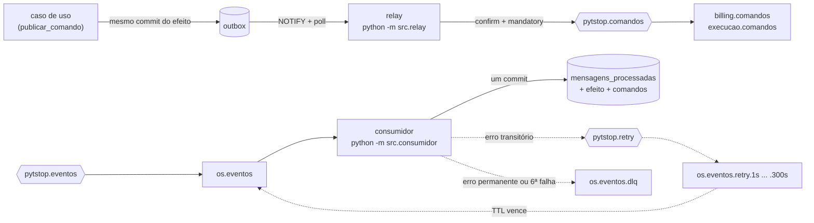
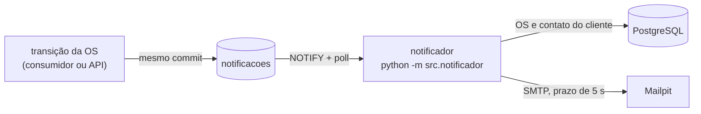

# Mensageria

Este documento detalha a seção [Mensageria](../README.md#mensageria) do README.

O OS Service orquestra a saga pelo RabbitMQ da plataforma, com AMQP (o protocolo do broker): publica comandos para Billing e Execução e consome os eventos que eles publicam ([ADR-036](https://github.com/fiap-postech-sw-architecture/postech-sw-arch-p4-platform/blob/main/docs/arquitetura/adr/fase4/036-mensageria-rabbitmq.md), [RFC-004](https://github.com/fiap-postech-sw-architecture/postech-sw-arch-p4-platform/blob/main/docs/arquitetura/rfc/fase4/rfc-004-microsservicos-saga.md) seção 5). A entrega é pelo menos uma vez e o consumidor é idempotente: cada efeito acontece uma vez (RN-028).



## Contratos

`contratos/` é cópia de arquivos do platform no SHA gravado em `contratos/ORIGEM` (um commit da `main` de lá): do `contratos/` de lá, o AsyncAPI (`asyncapi.yaml`), um JSON Schema por mensagem e os exemplos; em `contratos/rabbitmq/`, a topologia do broker do `k8s/base/rabbitmq/` (definitions, permissões, configuração e o script que cria os usuários) e o admin de demonstração do `compose/`. O `tests/contratos/test_copia_do_platform.py` baixa o platform nesse SHA uma vez (com novas tentativas) e compara cada arquivo byte a byte; atualizar a cópia é copiar de novo e trocar o `ORIGEM`. Os `pattern` de data, hora, dinheiro, URL, código, placa e tipo terminam em `(?![\s\S])`, que recusa a quebra de linha no fim do valor (o `$` a aceita), e um teste confere que nenhum `pattern` dos schemas volta ao `$`. O `sku` do `ReservarPecas` é mais estrito que o `codigo` dos itens do diagnóstico e do `GerarOrcamento`: só o formato do Billing, dono dos códigos (letras maiúsculas e dígitos separados por hífens, até 50 caracteres). O que isso muda para um código fora desse formato está em [Evento fora de ordem](saga.md#evento-fora-de-ordem).

O catálogo sai do próprio `asyncapi.yaml`: quem publica cada tipo (o `userId` da operação de envio), em que exchange e routing key, e o que a fila `os.eventos` recebe. Os eventos internos da OS (abertura e mudança de status) ficam no histórico e não vão para o broker.

| | Mensagens |
|---|---|
| O OS publica (11 comandos, enum `Comando`) | `SolicitarDiagnostico`, `DescartarDiagnostico`, `GerarOrcamento`, `CancelarOrcamento`, `ReservarPecas`, `LiberarReserva`, `SolicitarPagamento`, `EstornarPagamento`, `AgendarExecucao`, `CancelarExecucao`, `AnonimizarVeiculo` |
| O OS consome do Billing (13) | `OrcamentoGerado`, `GeracaoDeOrcamentoFalhou`, `OrcamentoAprovado`, `OrcamentoRecusado`, `OrcamentoExpirado`, `OrcamentoCancelado`, `PagamentoSolicitado`, `PagamentoConfirmado`, `PagamentoRecusado`, `PagamentoExpirado`, `PagamentoCancelado`, `PagamentoEstornado`, `EstornoDePagamentoFalhou` |
| O OS consome da Execução (10) | `DiagnosticoIniciado`, `DiagnosticoConcluido`, `DiagnosticoDescartado`, `PecasReservadas`, `ReservaDePecasFalhou`, `ReservaLiberada`, `ExecucaoAgendada`, `ExecucaoCancelada`, `ExecucaoIniciada`, `ExecucaoFinalizada` |

A validação usa o payload de cada mensagem no AsyncAPI: envelope, `tipo`, `versao` e `origem` constantes e o schema de `dados`. O leitor é tolerante (campo novo não invalida) e `versao` desconhecida reprova. O erro aponta o caminho e a regra (`const em $.versao`), nunca o valor, que pode ser a placa ou texto livre.

## Publicar um comando

Na API (e em todo processo sem mensagem de entrada), o caso de uso grava o comando na outbox pela própria unidade de trabalho, no mesmo commit do efeito. O trecho roda com o banco do compose (`set -a && . ./.env && set +a` antes):

```python
from uuid import uuid4

from src.compartilhado.aplicacao.mensageria import Comando
from src.compartilhado.infraestrutura.database import (
    criar_engine,
    criar_session_factory,
    resolver_database_url,
)
from src.compartilhado.infraestrutura.unit_of_work import SQLAlchemyUnitOfWork

ordem_id = uuid4()
uow = SQLAlchemyUnitOfWork(criar_session_factory(criar_engine(resolver_database_url())))
with uow:
    uow.publicar_comando(
        Comando.DESCARTAR_DIAGNOSTICO,
        {"ordem_id": ordem_id, "motivo": "cancelamento"},
        correlation_id=ordem_id,  # o id da OS, que tambem identifica a saga
    )
    uow.commit()
```

No consumidor, o handler recebe a mensagem e a `TransacaoDaMensagem`: monta os repositórios sobre a `session` dela, grava o efeito e publica os comandos nela, sem comitar. O consumidor comita uma vez efeito, comandos e o registro em `mensagens_processadas`; commit, rollback ou close pela `session` dentro do handler, ou um retorno que não é `Desfecho`, mandam a mensagem para a DLQ (fila de mensagens mortas) sem gravar nada. A guarda não alcança o que passa por baixo da `session`, que grava o efeito antes do consumidor: o `commit()` da transação raiz com um savepoint aberto manda a mensagem para a DLQ (o redrive vira `duplicada`), o `session.connection().commit()` faz o commit do consumidor falhar e a mensagem volta pela retry como `duplicada` (o que o handler gravasse depois se perde), e o `COMMIT` em SQL literal (`session.execute(text("COMMIT"))`) passa sem guarda nenhuma. Por isso o handler usa só a `session` e os repositórios:

```python
def tratar_diagnostico_concluido(
    mensagem: MensagemRecebida, transacao: TransacaoDaMensagem
) -> Desfecho:
    ordens = OrdemDeServicoSQLAlchemyRepository(session=transacao.session)
    if ordens.obter_por_id(mensagem.correlation_id) is None:
        return Desfecho.IGNORADA
    transacao.publicar_comando(
        Comando.GERAR_ORCAMENTO,
        {"ordem_id": mensagem.correlation_id, "itens": mensagem.dados["itens"]},
        correlation_id=mensagem.correlation_id,
        causation_id=mensagem.id,
    )
    return Desfecho.PROCESSADA
```

O envelope (`id`, `tipo`, `versao`, `origem=os-service`, `correlation_id`, `causation_id`, `ocorrido_em` em UTC e `dados`) é validado na hora: comando fora do contrato é bug e sobe como 500. A linha guarda o envelope, o exchange, a routing key e o contexto W3C (`traceparent`, `tracestate`) do span corrente; os tempos dela são do relógio do banco.

## Relay (`python -m src.relay`)

- Acorda com o `NOTIFY` da outbox e, por segurança, a cada `OUTBOX_POLL_SEGUNDOS`. Reivindica lotes com `FOR UPDATE SKIP LOCKED` e um lease, na ordem de cada OS: uma linha em espera segura as seguintes da mesma OS, e `dead` não segura.
- Nenhuma transação fica aberta durante a publicação: claim, renovação do lease antes de publicar e desfecho são transações curtas, e o fim do lease gravado no claim é o token da réplica. Quem perdeu a linha (o lease venceu e outra réplica a reivindicou) não grava o desfecho por cima. A entrega é pelo menos uma vez: um publish que passa do lease pode sair também pela outra réplica, e o consumidor do destino descarta a repetição pelo `id`.
- Publica com *publisher confirms* e `mandatory`, com as propriedades AMQP do contrato (`message_id`, `correlation_id`, `type`, `user_id=os`, `content_type`, `delivery_mode=2`) e o `traceparent` no header. A linha só vira `entregue` depois da confirmação.
- Mensagem devolvida (sem fila para a routing key), recusada (nack), canal fechado pelo broker ou qualquer outra falha da própria linha conta tentativa e volta depois de 1, 4, 16 e 64 s; na quinta falha vira `dead` (métrica `outbox_dead`). Envelope fora do contrato vira `dead` direto.
- Broker fora do ar não conta tentativa: sem conexão o relay não reivindica linhas e reconecta com backoff (espera sorteada entre 0 e um teto que dobra de 1 s até 30 s), e as linhas de um lote interrompido voltam na hora. Com o broker em alarme de memória ou disco, a conexão bloqueada para os claims até o desbloqueio, e o timeout do bloqueio (30 s) derruba a conexão como uma queda.
- Uma vez por hora apaga, em lotes de 1000, as linhas entregues há mais de 7 dias e as `dead` há mais de 30, contados da morte da linha e não da criação (a janela para o redrive); `pendente` nunca expira.

## Consumidor (`python -m src.consumidor`)

Para cada mensagem da fila `os.eventos`, uma por vez (prefetch 1) e com ack manual:

1. Origem: o `user_id` (o broker garante que é o usuário da conexão de quem publicou) tem de ser o produtor do `tipo` no catálogo; a cópia que volta da fila de retry traz o `user_id` do próprio consumidor e só é aceita com `x-tentativa` de 1 a 5. Sem `user_id`, ou qualquer outro caso, vai para a DLQ.
2. Trace: o span CONSUMER é filho do `traceparent` recebido.
3. Contrato: corpo de até 64 KiB, JSON, envelope e `dados` validados; `message_id`, `correlation_id` e `type` têm de bater com o envelope. Antes da validação, só o `message_id` e o `correlation_id` convertidos em UUID vão para o log e o span.
4. Efeito: grava o `id` em `mensagens_processadas` e chama o handler do `tipo` no despachante (`montar_despachante`, em `src/consumidor.py`: os 23 eventos vão ao orquestrador da saga) com a transação da mensagem; o consumidor comita e só então dá ack. Id repetido recebe ack sem efeito.

| Situação | Resultado |
|---|---|
| Handler concluiu | ack (`processada`, ou `ignorada` quando a mensagem não corresponde ao estado atual) |
| Mesmo `id` de novo | ack sem efeito (`duplicada`) |
| Erro transitório (banco fora, `FalhaTransitoriaError`, conflito de versão) | cópia em `pytstop.retry` com `x-tentativa` + 1 e a routing key da fila do nível (`os.eventos.retry.1s`, `.5s`, `.15s`, `.60s` e `.300s`), com confirmação e `mandatory`, e só então o ack (`retry`); a cópia leva as propriedades da original e o contexto de trace do consumo |
| Sexta falha transitória, tipo, versão, contrato ou origem inválidos, cópia de retry devolvida ou recusada, `FalhaPermanenteError` do handler (com o motivo dela em código no log) ou outra exceção do handler | `reject` sem requeue, e a fila manda para `os.eventos.dlq` (`dlq`); o `id` não entra em `mensagens_processadas`, e o redrive trata a mensagem de novo |

Cada nível de atraso tem a sua fila, com o TTL (tempo de vida da mensagem) como argumento dela: uma fila só, com `expiration` por mensagem, seguraria a cópia de 1 s atrás da de 300 s, porque a mensagem só expira na cabeça da fila. Uma mensagem que o cliente AMQP não consegue nem decodificar (um header de timestamp fora do intervalo, por exemplo) derruba a conexão a cada entrega: com prefetch 1 só ela cai, e o `delivery-limit` de 5 da fila (policy do platform) a manda para a DLQ sem levar as seguintes. Uma vez por hora o consumidor apaga, em lotes, as linhas de `mensagens_processadas` com mais de 30 dias.

## Observabilidade, saúde e encerramento

- Spans: `publish <tipo>` (PRODUCER, filho do span que gravou a outbox) e `process <tipo>` (CONSUMER, filho da publicação), com o `correlation_id` (o id da OS) no atributo `messaging.message.conversation_id` e, na falha, o status de erro e o atributo `pytstop.falha` só com o tipo da exceção ou um código fixo; os laços ociosos não abrem span. O SDK do OpenTelemetry fica sempre ligado no relay, no consumidor e no `prazos` (que abre o `saga prazo` só com trabalho), e `OTEL_ENABLED=true` liga a exportação OTLP (o protocolo do OpenTelemetry) para o Jaeger e a instrumentação do banco. O recurso leva `service.name` (de `OTEL_SERVICE_NAME`) e `pytstop.processo` (`api`, `relay`, `consumidor` ou `prazos`). O `notificador` não abre span: a linha de e-mail não guarda o contexto de trace. Tudo sobre spans e métricas está na [seção Observabilidade](observabilidade.md#observabilidade).
- Logs JSON com `correlation_id`, `trace_id` e `span_id`, sem dados pessoais nem texto livre: o envelope não vai para o log, e do cliente AMQP só sai o nível ERROR (em WARNING ele imprime o corpo da mensagem devolvida).
- Métricas no `/metrics` de cada processo (porta `METRICS_PORT`, 9100): a lista, os rótulos e o momento em que cada série conta estão na [tabela da seção Observabilidade](observabilidade.md#métricas). As séries de rótulo fechado nascem com zero no boot.
- Saúde: cada processo toca `/tmp/<processo>-heartbeat` a cada volta do laço, a cada linha do lote do relay e entre os lotes da limpeza (liveness), e mantém `/tmp/<processo>-pronto` enquanto está conectado ao broker (readiness; o `notificador` não fala com o broker, e o seu pronto é o banco respondendo). Broker fora, inclusive com o nome dele sem resolução no DNS (o Service headless sem pod pronto) e o broker que aceita a conexão TCP e não responde o AMQP no prazo do cliente (15 s), tira o processo de pronto sem reiniciá-lo, e ele reconecta com backoff (o `prazos` reconecta a cada ciclo, sem backoff: os `PRAZOS_INTERVALO_SEGUNDOS` entre os ciclos espaçam as tentativas); a tentativa que falha toca o heartbeat de novo, porque a resolução do nome não tem prazo no cliente AMQP. Falta de descritores, certificado TLS recusado e erro de disco no arquivo de saúde não são broker fora: derrubam o processo, para o Kubernetes reiniciá-lo e o defeito aparecer. A sonda de liveness tolera 90 s sem heartbeat (120 s no `prazos`): com o broker mudo um publish fica até cerca de 70 s preso antes de o heartbeat AMQP (30 s) derrubar a conexão, e com o broker em alarme até 30 s. No SIGTERM o processo termina a mensagem em curso e fecha as conexões; no consumidor, as demais seguem na fila, e no `prazos` as sagas vencidas que sobram ficam para o ciclo do processo seguinte.
- Banco: relay, consumidor, `prazos` e notificador usam um pool de 2 + 2 conexões e sessões com `statement_timeout` de 15 s e `lock_timeout` de 10 s, abaixo da janela do heartbeat do broker (o handler roda na thread da conexão AMQP).

## Configuração

| Variável | Padrão | Uso |
|---|---|---|
| `RABBITMQ_URL` | obrigatória | URL AMQP com o usuário `os`; fora de `development` e `test`, a senha de demonstração é recusada no boot (a do Postgres também) |
| `METRICS_PORT` | 9100 | porta do `/metrics` do relay, do consumidor, do `prazos` e do notificador |
| `OUTBOX_POLL_SEGUNDOS` | 5 | poll de segurança do relay, de 0,1 a 15 s (o laço ocioso atende o heartbeat AMQP) |
| `OUTBOX_LOTE` | 10 | linhas por lote do relay (1 ou mais) |
| `OUTBOX_LEASE_SEGUNDOS` | 60 | lease de cada linha reivindicada (45 ou mais: cobre o publish bloqueado por alarme do broker, de até 30 s, e a marcação da linha) |
| `OTEL_ENABLED`, `OTEL_EXPORTER_OTLP_ENDPOINT` | `false`, `http://jaeger:4317` | exportação OTLP dos spans e instrumentação do FastAPI e do banco (o compose a deixa desligada, e o kind a liga) |
| `OTEL_BSP_EXPORT_TIMEOUT`, `OTEL_EXPORTER_OTLP_TIMEOUT` | 30000 ms, 10 s do SDK; 2000 ms e 2 s no compose e no ConfigMap | prazos do envio dos spans: com o Jaeger fora e a fila cheia, a API levou 30,5 s para sair com o padrão do OTLP e 8,1 s com 2 s ([medição](observabilidade.md#encerramento-com-o-exportador-fora)); o `OTEL_BSP_EXPORT_TIMEOUT` não muda nada no SDK 1.45 |
| `OTEL_SERVICE_NAME` | `pytstop-os-service` | `service.name` dos spans |
| `SAGA_PRAZO_RESPOSTA_SEGUNDOS` | 120 | prazo técnico gravado pela saga no envio de cada comando com resposta automática (1 ou mais; [seção Saga](saga.md#saga)). Tem de ser o mesmo valor na API (a primeira compensação do cancelamento e a retomada), no consumidor e no processo `prazos`; no compose é um ponto só (`x-saga`) |
| `SAGA_MAX_REENVIOS` | 5 | reenvios do mesmo comando (0 ou mais) antes de compensar ou de parar a compensação; só o `prazos` lê ([Prazos, falha na compensação e retomada](saga.md#prazos-falha-na-compensação-e-retomada)) |
| `PRAZOS_INTERVALO_SEGUNDOS` | 30 | intervalo entre os ciclos do `prazos`, de 0,1 a 300 s; o alerta "Saga parada" do platform usa 60 s, duas vezes o padrão |
| `ROOT_PATH` | vazio | prefixo da API atrás do gateway (`/os` no cluster); o `entrypoint.sh` o passa ao uvicorn como `--root-path` e recusa, no boot, valor sem a barra inicial ou com a barra final |

Valor fora da faixa aborta o boot com a variável e o valor na mensagem.

## Notificações por e-mail e LGPD

### E-mail ao cliente

O cliente recebe um e-mail a cada mudança de situação da OS ([RFC-004](https://github.com/fiap-postech-sw-architecture/postech-sw-arch-p4-platform/blob/main/docs/arquitetura/rfc/fase4/rfc-004-microsservicos-saga.md) seção 3 e [ADR-036](https://github.com/fiap-postech-sw-architecture/postech-sw-arch-p4-platform/blob/main/docs/arquitetura/adr/fase4/036-mensageria-rabbitmq.md), "E-mail ao cliente"). O pedido nasce na transação da transição e o envio é de outro processo, então SMTP lento ou fora não atrasa comando, resposta nem a saga.



- **Quando.** Cada mudança de status da OS pede um e-mail do modelo do novo status, menos a abertura (`recebida`) e `aguardando_pagamento`, cujo e-mail é o do checkout, que o `PagamentoSolicitado` pede (ele não muda o status). O consumidor grava o pedido junto com o fato da saga e `mensagens_processadas`; a API, na entrega. O pedido de cancelamento (202) não muda a OS e não manda e-mail: o da `cancelada` sai quando a última compensação responde.

  | Modelo | Quando | Texto |
  |---|---|---|
  | `situacao` | `em_diagnostico`, `aguardando_execucao`, `em_execucao`, `finalizada`, `entregue` | o rótulo da situação |
  | `orcamento` | `aguardando_aprovacao` | total, validade e o `link_decisao` do Billing |
  | `pagamento` | `PagamentoSolicitado` | valor, validade e o `checkout_url` do Billing |
  | `cancelamento` | `cancelada` | o rótulo do código da compensação (nunca o texto do atendente) |

- **O pedido.** A tabela `notificacoes` (migração `004`, só expansão) guarda `ordem_id`, `modelo`, `status_da_ordem` e o `motivo` com o código, mais a situação da linha (`pendente`, `entregue` ou `dead`), as tentativas e o lease. Não tem endereço, nome, link nem texto livre: o nome e o endereço (extraído do campo livre `contato`) saem do cadastro, por uma projeção de duas colunas, sem carregar o agregado nem decifrar o documento, e por isso o `notificador` não recebe a `ENCRYPTION_KEY`; os links saem do resumo do orçamento e do pagamento que a OS guarda. A `outbox` não muda e continua só com comandos AMQP: um relay de uma versão anterior nunca vê um e-mail.
- **Entrega** (`python -m src.notificador`, a mesma imagem). Uma linha por vez, com o claim da outbox: `FOR UPDATE SKIP LOCKED` e lease com fencing, na ordem de cada OS (um e-mail em espera segura só os seguintes da mesma OS). A OS e o contato são lidos numa transação de leitura que fecha antes do envio. O envio é SMTP puro (`smtplib`, prazo de 5 s por operação); falha conta tentativa e volta depois de 1, 4, 16 e 64 s, e a quinta falha da linha a deixa `dead`, visível na tabela e no log. Não há métrica nem alerta próprios: o e-mail é complementar e não segura a saga. Cliente anonimizado (o contato virou marcador), sem e-mail no contato ou sem o resumo que o modelo pede: a linha é dada como entregue, sem envio, com um aviso no log. Uma vez por hora apaga as linhas entregues há mais de 7 dias e as `dead` há mais de 30.
- **Sem dado pessoal no log.** O log leva só `correlation_id` (a OS), `modelo` e o resultado: nunca o endereço, o nome, o `link_decisao` ou o `checkout_url`, e o `ultimo_erro` da linha é o nome da exceção. O processo não abre span nem tem métrica própria; o `/metrics` na 9100 traz só as métricas padrão do Python.
- **Saúde.** Heartbeat a cada volta do laço e arquivo de pronto enquanto o banco responde; SMTP fora não o tira de pronto. Encerramento gracioso no SIGTERM.

| Variável | Padrão | Uso |
|---|---|---|
| `SMTP_HOST` | `localhost` só em development/test | servidor SMTP (`mailpit` no compose; `mailpit.pytstop-plataforma.svc.cluster.local` no cluster). Fora de development/test é obrigatório: sem ele o notificador não sobe, em vez de mandar todo e-mail ao `localhost` do pod e deixá-lo `dead` |
| `SMTP_PORT` | 1025 | porta SMTP (1 ou mais); valor inválido aborta o boot |
| `SMTP_FROM` | `oficina@pytstop.local` | remetente |

No compose, o Mailpit mostra a caixa de entrada em `http://localhost:8026` (`MAILPIT_UI_PORT`) e recebe o SMTP em `localhost:1026` (`MAILPIT_SMTP_PORT`), fora das portas do compose do platform (8025 e 1025), para os dois conviverem. Sem credencial nem TLS: o Mailpit da demonstração não pede. **SMTP externo** exigiria STARTTLS e credencial por Secret, que o adapter ainda não implementa (a política de saída `notificador-saida` também teria de mudar); o link de decisão e o de pagamento vão no corpo do e-mail, então só um servidor de confiança deve recebê-lo.

**Rede no Kubernetes.** O notificador é o único processo do serviço com política de saída (`notificador-saida`: DNS, PostgreSQL do namespace e Mailpit na 1025), porque é o único com destino de rede de terceiro configurável (`SMTP_HOST`) e com escrita em todo o banco; a API, o relay, o consumidor e o `prazos` ficam sem política de saída, porque os destinos deles são fixos (o PostgreSQL do namespace e o RabbitMQ e o Jaeger da plataforma, e o `prazos` usa os três: exporta o span `saga prazo`). Um `SMTP_HOST` fora da regra não é recusado, apenas expira (os 5 s de cada tentativa) e os e-mails vão para `dead`: trocar o servidor exige ajustar a política. A política foi exercitada num kind (Mailpit:1025 e banco:5432 abrem; Mailpit:8025, broker:5672, a API do namespace e a internet fecham; o DNS resolve), e o smoke dos serviços do platform (`scripts/ci/smoke-servicos.sh`) repete a prova a cada CD: o notificador alcança o Mailpit na 1025 e a conexão dele ao broker na 5672 precisa esgotar o prazo. A regra de entrada no Mailpit é do platform.

### Operação do e-mail

- **Linha `dead`.** Sem métrica nem alerta próprios, a linha que esgotou as cinco tentativas fica na tabela e no log (`notification send failed; row dead`, com o `correlation_id` da OS). Para listá-las:

  ```sql
  SELECT id, ordem_id, modelo, status_da_ordem, tentativas, ultimo_erro
  FROM notificacoes WHERE situacao = 'dead' ORDER BY id;
  ```

- **Reenvio.** Depois de corrigir a causa (o SMTP voltou, o endereço do cliente foi ajustado), devolva a linha à fila; o notificador a pega no próximo ciclo (o `UPDATE` não emite `NOTIFY`, então vale o poll de 5 s). Só vale até a retenção de 30 dias, quando a limpeza horária apaga a linha:

  ```sql
  UPDATE notificacoes
  SET situacao = 'pendente', tentativas = 0, ultimo_erro = NULL, proxima_tentativa_em = now()
  WHERE id = 42 AND situacao = 'dead';  -- o id da consulta acima
  ```

  A `dead` não segura a fila da OS, então o e-mail reenviado chega depois dos seguintes da mesma OS que já saíram.
- **Ordem de implantação e rolling update:** ver [Implantação e DLQ](como-rodar.md#implantação-e-dlq).

### Eliminação de dados (LGPD)

`DELETE /api/v1/clientes/{id}/dados-pessoais` (admin) só vale sem OS ativa e, numa transação só, anonimiza:

- o cliente, os veículos e o texto livre das OS (descrição do problema e motivos de cancelamento);
- a placa e a descrição do `SolicitarDiagnostico` que ficaram na outbox, em qualquer situação da linha (pendente, entregue ou `dead`), achadas pelo `correlation_id` das OS do cliente: a placa vira `AAA0A00`, que respeita o padrão do schema (a linha pendente continua publicável e o relay segue validando o envelope), e a descrição vira `[removido]`; marca e modelo não identificam o titular e ficam;
- a placa guardada na Execução, por um comando `AnonimizarVeiculo` por veículo, fora da saga (o `correlation_id` é o `veiculo_id`, sem resposta nem prazo; a falha definitiva vai para a `execucao.comandos.dlq`). O `DELETE` repetido responde 204 de novo e não reenvia o comando: só os veículos que ainda guardam a placa original geram um.

Se a transação desfaz, nenhum comando sai e nada é anonimizado. A cópia do comando na `execucao.comandos.dlq` (7 dias) mantém a placa original: depois de um apagamento, **não faça redrive de DLQ de comando**, que recriaria a placa na Execução.

**Reenviar só um `AnonimizarVeiculo`.** Como o `DELETE` repetido não reemite o comando, o que cair na `execucao.comandos.dlq` (a Execução não anonimizou a placa) precisa de reenvio próprio. O comando leva só o `veiculo_id` (o `correlation_id` da mensagem na DLQ), sem placa. Publicá-lo à mão no exchange de comandos não funciona: o broker só aceita um `user_id` igual ao usuário da conexão, a Execução só aceita `os` como produtor desse tipo, e o usuário `os` não entra na API de gerenciamento (publicar como `admin` com `user_id` `os` volta 406, e sem `user_id` a Execução recusa o comando). O reenvio grava o comando de novo na outbox, na transação e com o contrato do erasure, e o relay o publica como `os`. Troque o `VEICULO_ID` pelo da mensagem na DLQ (a senha do banco já está no ambiente do pod) e rode, com prazo:

```bash
VEICULO_ID=3277db7e-8283-4dd9-89e7-df3eeacb8710
timeout 60 kubectl --context kind-pytstop-p4 -n pytstop-os exec deploy/os-service-consumidor -- python scripts/reenviar_anonimizacao.py "$VEICULO_ID"
```

No macOS sem o `timeout` do coreutils, troque-o por `perl -e 'alarm shift; exec @ARGV' 60`. O script sai com 1, sem enviar nada, para um veículo que não foi anonimizado (o comando de um veículo vivo apagaria a placa dele na Execução). A cópia na DLQ expira sozinha em 7 dias, e o redrive da fila inteira continua proibido: a mesma DLQ pode guardar um `SolicitarDiagnostico` com a placa original.

### Testes

- **Unitários.** O modelo de cada status e a exaustividade da tabela (`test_notificacoes.py`), o texto de cada e-mail, o que fica de fora dele e o aviso sem dado pessoal (`test_emails.py`), o adapter SMTP (`test_email_adapter.py`), o pedido gravado por cada evento do fluxo, de cada compensação e da corrida do pivot (`test_orquestrador_notificacoes.py`), um comando por veículo e a transação desfeita (`test_lgpd_use_cases.py`) e os manifestos e o compose do `notificador`.
- **Propriedade** (`test_propriedades_da_saga.py`): em mil sementes, com eventos embaralhados, repetidos e atrasados, um pedido de e-mail por transição de status e nunca dois, e o código do motivo só no cancelamento.
- **BDD** (`tests/bdd/notificacoes_do_cliente.feature`): os pedidos do caminho feliz, o cancelamento, a falha de negócio, o texto de cada modelo e o cliente apagado.
- **Integração.** A tabela, o claim (que só pega o modelo, o status e o motivo que esta versão conhece), o fencing de cada desfecho, o lease vencido que não devolve linha `entregue` nem `dead`, a ordem por OS, os atrasos até `dead` e a retenção (`test_fila_de_notificacoes.py`); o `notificador` com PostgreSQL e Mailpit reais (`test_notificador.py`); a saga com relay, consumidor, RabbitMQ, notificador e Mailpit, com um e-mail por gatilho, SMTP fora sem atrasar a saga e nenhum dado pessoal no log, nos spans e nas métricas (`test_notificacoes_da_saga.py`); o erasure com um comando por veículo, a outbox anonimizada e a linha anonimizada publicada pelo relay (`test_erasure_outbox.py`).
