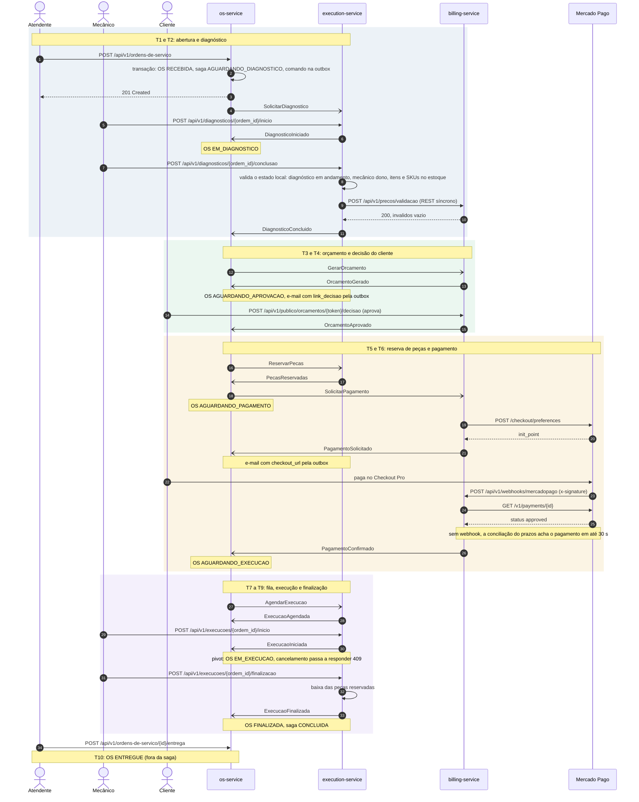
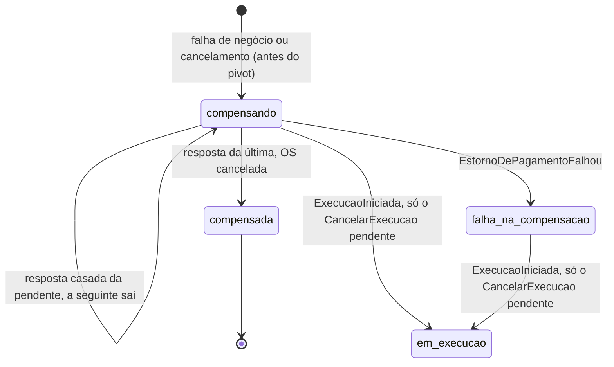
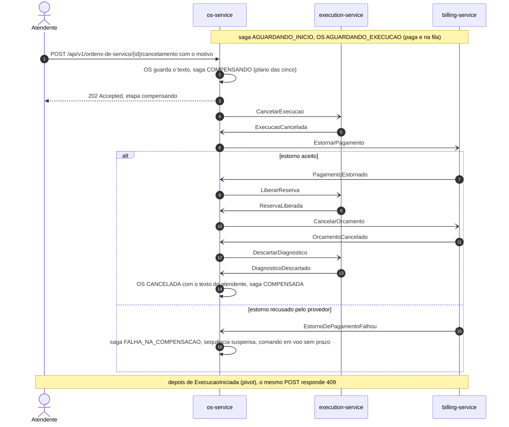

# Saga

Este documento detalha a seção [Arquitetura](../README.md#arquitetura) do README. A justificativa da orquestração fica no [README](../README.md#por-que-orquestração).

O OS Service orquestra a saga de atendimento ([ADR-035](https://github.com/fiap-postech-sw-architecture/postech-sw-arch-p4-platform/blob/main/docs/arquitetura/adr/fase4/035-saga-orquestrada.md), [RFC-004](https://github.com/fiap-postech-sw-architecture/postech-sw-arch-p4-platform/blob/main/docs/arquitetura/rfc/fase4/rfc-004-microsservicos-saga.md) seção 4). Há uma instância por OS, com `saga_id = ordem_id`, que também é o `correlation_id` de todas as mensagens.

- O orquestrador é um *process manager*: o objeto que guarda o estado da saga e, a cada evento, decide o próximo comando. Ele vive na camada de aplicação (`src/ordem_servico/aplicacao/saga/`), com estado e regras sem I/O, e é persistido como agregado próprio na tabela `sagas`, no mesmo PostgreSQL da outbox.
- A etapa da saga, o status da OS, o registro da transição na linha do tempo da saga e o comando seguinte entram no mesmo commit: na abertura, o da requisição; nos eventos, o do consumidor, junto com `mensagens_processadas`.

## Caminho feliz

O diagrama é o da RFC-004, seção 4.8a; setas abertas são mensagens assíncronas (outbox, relay, exchange, fila, consumidor).



O e-mail ao cliente do diagrama sai do processo `notificador`, e não da outbox de comandos ([Notificações por e-mail e LGPD](mensageria.md#notificações-por-e-mail-e-lgpd)).

## Etapas e status

Etapa (o estado do orquestrador) e status (o que cliente e atendente veem) são campos diferentes, com dois nomes em comum; a API, o banco e o label `etapa` das métricas usam os nomes em minúsculas.

| Etapa | Status da OS | Evento que tira a saga da etapa | Comando enviado |
|---|---|---|---|
| `aguardando_diagnostico` | `recebida`; `em_diagnostico` com `DiagnosticoIniciado` | `DiagnosticoConcluido` (com a OS em diagnóstico) | `GerarOrcamento`, com os itens do diagnóstico |
| `aguardando_orcamento` | `em_diagnostico` | `OrcamentoGerado` (a OS guarda o resumo) | nenhum |
| `aguardando_decisao` | `aguardando_aprovacao` | `OrcamentoAprovado` | `ReservarPecas`, com as peças dos itens (lista vazia vale) |
| `aguardando_reserva` | `aguardando_aprovacao` | `PecasReservadas` | `SolicitarPagamento` |
| `aguardando_pagamento` | `aguardando_pagamento` | `PagamentoConfirmado` (depois do `PagamentoSolicitado`, que grava o resumo) | `AgendarExecucao`, prioridade `normal` |
| `aguardando_agendamento` | `aguardando_execucao` | `ExecucaoAgendada` (a posição na fila fica só no passo) | nenhum |
| `aguardando_inicio` | `aguardando_execucao` | `ExecucaoIniciada` (pivot) | nenhum |
| `em_execucao` | `em_execucao` | `ExecucaoFinalizada` | nenhum |
| `concluida` | `finalizada`; `entregue` com a entrega (T10, fora da saga) | nenhum | nenhum |

A falha de negócio e o cancelamento levam a saga às etapas `compensando`, `compensada` e `falha_na_compensacao` (seção [Compensações e cancelamento](#compensações-e-cancelamento)); nelas o status da OS não muda, até a OS ficar `cancelada`.

- **O agregado `Saga` impõe a tabela** (`tabela_da_saga.py`, `transicoes.py`). Antes de mudar, ele confere que o evento é da OS e se classifica para ser processado (com os marcos da OS de antes do fato), que o instante não volta antes do último registro e que o gatilho do registro é do vocabulário fechado.
- **Confere o comando.** O comando enviado tem de ser o da linha, com o `ordem_id` da OS, os itens ou as peças que a saga guarda, o orçamento da OS no `SolicitarPagamento`, a prioridade `normal` no `AgendarExecucao`, os ids dos recursos nas compensações e o prazo técnico. O orquestrador só traduz cada evento em chamadas: o fato na OS, o comando na outbox e o registro na saga.
- **Um só caminho de envio.** A abertura, o orquestrador e o cancelamento gravam o comando pela mesma função (`enviar`, em `contexto_de_envio.py`), e o `ContextoDeEnvio` leva o prazo técnico, o relógio e o span da ação. O instante de cada passo nunca fica antes do último registro da saga, que pode ter vindo de outra réplica ou da API com o relógio um pouco adiantado; é a mesma política no consumidor e na API: com mais de 1 s de defasagem avisa no log `saga clock behind last record`, e com mais de 60 s recusa o passo (no consumidor, DLQ com o motivo `relogio_defasado`; no cancelamento, 500).
- **Causa.** Cada comando sai com `causation_id` = id do evento que o causou; o `SolicitarDiagnostico` da abertura, causado pela requisição, sai sem ele.
- **Comando em voo.** O comando com resposta automática (`GerarOrcamento`, `ReservarPecas`, `SolicitarPagamento` até o `PagamentoSolicitado` e `AgendarExecucao`) fica registrado na saga como o comando em voo, o que espera a resposta, com o prazo técnico (`prazo_resposta_em`, `SAGA_PRAZO_RESPOSTA_SEGUNDOS` depois do envio) e o id de cada envio (`mensagem_ids`), com que a resposta casa pelo `causation_id`. O `SolicitarDiagnostico` e as esperas humanas não têm prazo.
- **Só códigos.** A saga guarda etapa, gatilho, comando e ator; texto livre e placa ficam na OS e na mensagem.

## Evento fora de ordem

O consumidor entrega cada evento ao orquestrador, que o classifica pela etapa antes de tocar no domínio (RFC-004 seção 4.5). Os eventos que chegam durante uma compensação têm a tabela própria, em [Compensações e cancelamento](#compensações-e-cancelamento).

| Situação | Exemplo | Desfecho |
|---|---|---|
| Etapa do evento é a atual | `OrcamentoGerado` em `aguardando_orcamento` | processado: status, registro e comando seguinte |
| Etapa já passada, inclusive a resposta republicada | `OrcamentoGerado` em `aguardando_decisao` | ignorado com log (`saga event ignored`) |
| Mesma etapa, fato já aplicado | `DiagnosticoIniciado` com a OS já em diagnóstico; `PagamentoSolicitado` com o resumo gravado | ignorado com log |
| Etapa à frente da atual | `ExecucaoIniciada` antes da `ExecucaoAgendada` | adiantado (`FalhaTransitoriaError`): volta pela fila de retry até a saga alcançá-lo |
| Mesma etapa, antes do fato que o habilita | `DiagnosticoConcluido` com a OS ainda `recebida`; `PagamentoConfirmado` antes do `PagamentoSolicitado` | adiantado |
| Saga concluída | `ExecucaoFinalizada` repetida em `concluida` | ignorado com log |
| OS sem saga, ou `ordem_id` dos dados diferente do `correlation_id` | `DiagnosticoIniciado` de uma OS que não tem saga | erro permanente: DLQ com o motivo `saga_inexistente` ou `ordem_id_divergente` |
| OS cancelada ou entregue com a saga viva (estado que o cancelamento recusa) | `PagamentoConfirmado` de uma OS que um `UPDATE` por fora deixou `cancelada` | DLQ com o motivo `ordem_encerrada`: nenhum comando para OS encerrada |
| Fato que a OS ou a saga recusam | `PagamentoSolicitado` com a OS fora de `aguardando_pagamento` | DLQ com o motivo `transicao_invalida` |
| `OrcamentoAprovado` de uma saga com peça de código fora do formato do Billing | `pec_vela.2` (minúsculas, `.` ou `_`): o diagnóstico e o `GerarOrcamento` aceitam, o `sku` do `ReservarPecas` não | DLQ com o motivo `erro_no_handler`; a saga fica em `aguardando_decisao` até o cancelamento da OS |
| Relógio desta réplica mais de 60 s atrás do último registro da saga (de outra réplica ou da API) | réplica com o relógio 90 s atrás do `em` do último registro | DLQ com o motivo `relogio_defasado`: não é jitter, e gravaria `em` e prazos no futuro; até 60 s o registro fica no instante do anterior |

**Peça com código fora do formato do Billing.** O `sku` do `ReservarPecas` é só o formato do Billing (maiúsculas, dígitos e hífens, até 50 caracteres), e o diagnóstico e o `GerarOrcamento` aceitam mais. O fluxo real não produz o caso: o Billing só cota código nesse formato e responde `GeracaoDeOrcamentoFalhou` aos outros, e a saga compensa. Se a aprovação vier mesmo assim, o comando não é montado (`ContratoInvalidoError`), a transação desfaz e nada vai para a outbox; o redrive repete a falha enquanto o código seguir fora do formato. A `os.eventos.dlq` guarda a mensagem por 7 dias, com o alerta "DLQ com mensagens"; depois disso nada acusa a saga em `aguardando_decisao`, que não tem prazo técnico (o `prazos` só reivindica saga com prazo de resposta e o alerta "Saga parada" não a vê) e deixa o orçamento aprovado no Billing. Cancele a OS antes, com `POST /api/v1/ordens-de-servico/{id}/cancelamento` (202 nessa etapa). Uma linha de `ReservarPecas` já pendente na outbox com esse SKU vai para `dead` no relay e nada chega ao broker: nem a DLQ nem o prazo da saga a acusam: quem acusa é a métrica `outbox_dead` e o alerta "Outbox com mensagem dead" do platform.

O descompasso de estado (etapa já passada, fato repetido, saga encerrada) é ignorado com log e nunca vai para a DLQ. O adiantado volta pela fila de retry nas cinco cópias (1, 5, 15, 60 e 300 s, 381 s ao todo), bem mais que o atraso entre eventos do mesmo passo; se a saga ainda não o tiver alcançado, a sexta falha vai para a DLQ, com alerta (RFC-004 seção 4.5, ADR-035). O motivo de cada recusa sai em código no log `message rejected to dlq` e no status de erro do span do consumo.

A mensagem que o consumidor recusa não entra em `mensagens_processadas` (ADR-036): o redrive da DLQ a trata de novo. A `os.eventos.dlq` guarda cada mensagem por 7 dias (`message-ttl` da política `dlq` em `contratos/rabbitmq/definitions.json`); o procedimento está em [Implantação e DLQ](como-rodar.md#implantação-e-dlq).

## Compensações e cancelamento

Termos desta seção:

- **Plano:** as compensações que a saga ainda tem de enviar, na ordem fixa `CancelarExecucao`, `EstornarPagamento`, `LiberarReserva`, `CancelarOrcamento`, `DescartarDiagnostico`. É uma função pura (`aplicacao/saga/compensacao.py`), calculada quando a saga entra em `compensando` e gravada em `plano_compensacao`.
- **Pendente:** a primeira compensação do plano, a que espera resposta (é o comando em voo).
- **Resposta casada:** a resposta cujo `causation_id` é o id de um envio do comando em voo (um dos `comando_em_voo.mensagem_ids`).
- **Estorno automático:** o `PagamentoEstornado` que o Billing publica sozinho, com o `motivo` `pagamento_apos_encerramento`, quando o cliente paga depois de a cobrança ser cancelada, expirada ou recusada (ADR-040). A causa dele é o `SolicitarPagamento`, e não o `EstornarPagamento`.
- **Corrida do pivot:** o `ExecucaoIniciada` que chega com a compensação em curso ou parada, porque a Execução iniciou antes de receber o `CancelarExecucao`.

Entra no plano a compensação de cada passo concluído ou em voo, menos o que a falha de negócio já encerrou no participante; o `DescartarDiagnostico` entra sempre ([RFC-004 seção 4.4](https://github.com/fiap-postech-sw-architecture/postech-sw-arch-p4-platform/blob/main/docs/arquitetura/rfc/fase4/rfc-004-microsservicos-saga.md)):

| Etapa | Gatilho | Compensações, em ordem |
|---|---|---|
| `aguardando_diagnostico` | cancelamento | `DescartarDiagnostico` |
| `aguardando_orcamento` | `GeracaoDeOrcamentoFalhou` | `DescartarDiagnostico` |
| `aguardando_orcamento` | cancelamento (ou prazo técnico), com o `GerarOrcamento` em voo | `CancelarOrcamento`, `DescartarDiagnostico` |
| `aguardando_decisao` | `OrcamentoRecusado` ou `OrcamentoExpirado` | `DescartarDiagnostico` |
| `aguardando_decisao` | cancelamento | `CancelarOrcamento`, `DescartarDiagnostico` |
| `aguardando_reserva` | `ReservaDePecasFalhou` | `CancelarOrcamento`, `DescartarDiagnostico` |
| `aguardando_reserva` | cancelamento (ou prazo técnico), com o `ReservarPecas` em voo | `LiberarReserva`, `CancelarOrcamento`, `DescartarDiagnostico` |
| `aguardando_pagamento` | `PagamentoRecusado` ou `PagamentoExpirado` | `LiberarReserva`, `CancelarOrcamento`, `DescartarDiagnostico` |
| `aguardando_pagamento` | cancelamento (antes do `PagamentoSolicitado` ou com o checkout aberto) | `EstornarPagamento`, `LiberarReserva`, `CancelarOrcamento`, `DescartarDiagnostico` |
| `aguardando_agendamento` | cancelamento (ou prazo técnico), com o `AgendarExecucao` em voo | as cinco |
| `aguardando_inicio` | cancelamento | as cinco |

Os estados da compensação e o que move a saga entre eles:



O cancelamento depois do pagamento, com o estorno (RFC-004 seção 4.8d, sem a retomada do admin):



Os eventos que chegam durante a compensação:

| Situação | Exemplo | Desfecho |
|---|---|---|
| Falha de negócio na etapa do passo que falha | `OrcamentoRecusado` em `aguardando_decisao` | processado: a compensação começa pela primeira do plano |
| Resposta da compensação pendente | `ExecucaoCancelada` com o `CancelarExecucao` pendente; as três do `EstornarPagamento` só se forem casadas | processado: a seguinte sai, ou a saga termina |
| Resposta de compensação que não é a da pendente, ou fora de `compensando` | `ReservaLiberada` com o `EstornarPagamento` pendente; qualquer resposta em `falha_na_compensacao` | ignorado com log |
| Evento do fluxo normal com a saga em compensação ou compensada | `OrcamentoAprovado` ou `PagamentoConfirmado` atrasados | ignorado com log: a compensação já cancela o orçamento e devolve o pagamento |
| Estorno automático, em qualquer etapa | `PagamentoEstornado` com `pagamento_apos_encerramento` e o `causation_id` do `SolicitarPagamento` | só o resumo do pagamento passa a `estornado`, se a OS o tiver: sem etapa nova, sem comando e sem registro, com o log `late payment refunded` (sem resumo, ou já estornado, ignorado com log) |
| Corrida do pivot | `ExecucaoIniciada` com só o `CancelarExecucao` pendente | a saga volta a `em_execucao`, e a OS descarta o texto do pedido |
| `ExecucaoIniciada` com outra compensação pendente | `ExecucaoIniciada` com o `EstornarPagamento` pendente | ignorado com log de erro: o `CancelarExecucao` já foi respondido |
| `ExecucaoFinalizada` com o `CancelarExecucao` pendente | | adiantado: volta pela retry até o `ExecucaoIniciada` chegar |

Como a saga se comporta:

- **Uma por vez.** Cada compensação espera a resposta da anterior, com o prazo técnico gravado pela saga no envio. A resposta da última leva a saga a `compensada` e a OS a `cancelada`.
- **Dados do comando.** `{ordem_id, motivo}`, em que `motivo` é o código da compensação e nunca o texto do atendente, mais o `orcamento_id` no `CancelarOrcamento` e o `pagamento_id` no `EstornarPagamento` quando a OS já os tem (sem eles o participante acha o recurso pelo `ordem_id`).
- **A OS cancelada.** Tem origem `saga` e o motivo que o atendente escreveu ou, nas falhas de negócio, o rótulo do código (`ROTULO_DO_MOTIVO`: "Orçamento recusado pelo cliente", "Falta de peça para a reserva", "Pagamento não realizado no prazo"...). O `ator` da mudança é o `sub` do atendente que pediu o cancelamento e, nas falhas de negócio, o processo `consumidor` (ADR-039).
- **Resposta casada.** Com o `EstornarPagamento` pendente, concluem a compensação o `PagamentoCancelado` e o `PagamentoEstornado` (de qualquer `motivo`) casados, e o `EstornoDePagamentoFalhou` casado leva a saga a `falha_na_compensacao`. O `motivo` não serve de chave: o Billing responde ao comando com `pagamento_apos_encerramento` quando a aprovação tardia já tinha sido estornada.
- **Resumo do pagamento.** A OS passa o resumo a `cancelado` ou `estornado` com a resposta, quando o tem (`ResumoPagamento.cancelado()` e `.estornado()`). O cancelamento só atinge a cobrança em aberto e o estorno aceita qualquer origem; nenhuma das duas recusa a resposta do Billing. Se o estorno automático chegou antes e o resumo já está `estornado`, a resposta casada deixa o resumo como está e a compensação avança, em qualquer ordem de chegada entre as réplicas do consumidor.
- **Falha na compensação.** Duas causas a levam: o `EstornoDePagamentoFalhou` (`falha=estorno_recusado`) e a compensação sem resposta depois dos reenvios (`falha=reenvios_esgotados`). A sequência para: o compensado fica compensado, o resto como estava e a OS mantém o status. A saga guarda a `falha`, o plano com a pendente em primeiro lugar e o comando em voo **sem prazo**, com os ids de todos os envios (a resposta tardia ao original ainda casa depois da retomada). A resposta que chega em `falha_na_compensacao` é ignorada, salvo o estorno automático (só o resumo) e o `ExecucaoIniciada` com o `CancelarExecucao` parado. O reenvio por prazo e a retomada pelo admin estão em [Prazos, falha na compensação e retomada](#prazos-falha-na-compensação-e-retomada).
- **Corrida do pivot.** Se o `ExecucaoIniciada` vence o cancelamento, a saga e a OS voltam a `em_execucao`: o texto do pedido é descartado, motivo, plano e falha se limpam, e o registro tem o gatilho `cancelamento_recusado` com o `mensagem_id` do evento. Se o cancelamento venceu, o `ExecucaoIniciada` que chega depois é ignorado com log de erro.
- **Registros.** O gatilho de cada registro é o tipo da mensagem ou uma palavra da lista fechada `abertura`, `cancelamento_solicitado`, `cancelamento_recusado`, `reenvio`, `prazo_esgotado` e `retomada`; a saga recusa outro, e o `GET /api/v1/sagas/{ordem_id}` documenta a lista.

`POST /api/v1/ordens-de-servico/{id}/cancelamento` (atendente, corpo `{"motivo": "texto livre"}`) responde:

| Etapa | Resposta |
|---|---|
| `aguardando_*` (antes do pivot) | **202** com a OS e `etapa: "compensando"`: a OS guarda o texto em `motivo_cancelamento` sem mudar o status, a saga entra em `compensando` com `motivo=cancelamento` e a primeira compensação sai no mesmo commit, com o registro `cancelamento_solicitado` |
| `compensando` ou `falha_na_compensacao` | **202** com a etapa atual, sem efeito: o pedido repetido não grava texto, registro nem comando |
| `em_execucao` ou `concluida` | **409** `TRANSICAO_STATUS_INVALIDA`, "Cancelamento recusado: execução já iniciada" (RN-029) |
| `compensada` | **409** `TRANSICAO_STATUS_INVALIDA`, "Ordem já cancelada" |
| Conflito de versão com o consumidor que persiste nas três leituras | **409** `CONFLITO_DE_CONCORRENCIA` |
| OS inexistente, ou sem saga (toda OS tem saga desde a migração `003`) | **404** `ENTIDADE_NAO_ENCONTRADA`; não há cancelamento direto |
| Motivo vazio, em branco, com mais de 500 caracteres ou com caractere de controle ou de formatação (ver "Texto livre", abaixo) | **422** `VALOR_INVALIDO`, no envelope do domínio, antes de qualquer efeito |
| Corpo fora do schema (sem `motivo`, campo a mais, tipo errado) | **422** no formato da validação de schema dos três serviços, `{detail, id_requisicao}` |

```bash
curl -s -X POST localhost:8000/api/v1/ordens-de-servico/$ORDEM_ID/cancelamento \
  -H "Authorization: Bearer $TOKEN" -H 'Content-Type: application/json' \
  -d '{"motivo": "Cliente vendeu o veículo"}' | jq '{status, etapa, motivo_cancelamento}'
```

Com a OS recém-aberta (sem resposta dos participantes ainda), a resposta é `{"status": "recebida", "etapa": "compensando", "motivo_cancelamento": "Cliente vendeu o veículo"}`; repetido o mesmo `POST`, vem outro 202, sem efeito, e depois do início da execução vem o 409 da tabela.

- **Conflito de versão.** Quando o consumidor grava a mesma OS ou saga no meio, a requisição relê as duas e decide de novo, até três leituras (*reread value*, RFC-004 seção 4.5).
- **O texto do atendente.** O `motivo_cancelamento` é o texto do pedido, guardado já no 202, enquanto a OS segue com o status anterior. Quem lê a OS vê o texto com a etapa `compensando`, e ele volta a `null` se o início da execução vencer o pedido. As OS canceladas diretamente, antes de o cancelamento passar pela saga, guardam o texto no mesmo campo.
- **Onde o texto fica.** Em `ordens_de_servico.motivo_cancelamento` e, depois de a OS ser cancelada, em `historico_status_ordem.motivo` (devolvido por `GET /{id}/historico`). O apagamento LGPD do cliente anonimiza as duas colunas, e a saga guarda só códigos.
- **Texto livre.** A descrição do problema (`POST /api/v1/ordens-de-servico`, até 1000 caracteres) e o motivo do cancelamento (até 500) passam pela mesma validação, no domínio: o texto entra aparado (CRLF vira LF), e a violação volta como 422 `VALOR_INVALIDO`.
  - **Recusa:** o texto vazio, o que passa do limite e os caracteres das categorias Unicode `Cc` (controle, como o NUL e o CR solto), `Cf` (formatação: espaço de largura zero, override bidirecional, marca de direção), `Zl` e `Zp` (separador de linha e de parágrafo). A quebra de linha e a tabulação passam.
  - **Passa:** acentos, o espaço sem quebra e o emoji simples, com tom de pele, bandeira ou variação de apresentação.
  - **Falso positivo conhecido:** o emoji composto por junção de largura zero (`👨‍🔧`, `👩‍💻`, as famílias), o hífen condicional e a marca esquerda-direita também são `Cf` e voltam 422 com `<campo> tem caractere de controle ou de formatacao`, sem dizer qual. Texto colado do WhatsApp ou do Word pode trazê-los.
  - **Decisão:** manter a categoria `Cf` inteira recusada. O atendente lê o texto na tela e a LGPD o alcança, e o override bidirecional e o espaço de largura zero escondem ou reordenam o que se lê. Liberar só a junção entre dois pictogramas pediria a propriedade Emoji do Unicode, que o `unicodedata` do Python não tem, e uma lista de pictogramas que cresce a cada versão do Unicode. O custo é o atendente tirar o caractere ou trocar o emoji composto pelo simples; `test_texto_livre.py` fixa os dois lados.
- **Auditoria (ADR-039).** Cada pedido deixa uma linha de log com `correlation_id` (a OS), `ator` (o `sub` de quem pediu) e `resultado`: `order cancellation requested` com `aceito` ou `repetido` (e a `etapa`), ou `order cancellation refused` com o código do erro. Nunca o texto do motivo. O `sub` fica também no registro `cancelamento_solicitado` da saga e no `ator` da mudança `cancelada` do histórico. Só o que chega ao caso de uso é auditado: o corpo fora do schema (422 de schema) e as falhas inesperadas (500, como o relógio defasado ou a invariante da saga violada) saem apenas pelo log genérico da requisição ou do erro, sem `ator` nem `correlation_id`.
- **Cliente com OS em andamento.** Enquanto a OS tem compensação em andamento ela segue ativa, e a desativação e o apagamento do cliente respondem 409 até a saga terminar (`existe_os_ativa_para_cliente` só libera a OS entregue ou cancelada).

## Prazos, falha na compensação e retomada

Termos desta seção:

- **Prazo técnico:** quanto o OS espera a resposta automática de um comando (`GerarOrcamento`, `ReservarPecas`, `SolicitarPagamento` até o `PagamentoSolicitado`, `AgendarExecucao` e as cinco compensações por comando; a sexta, a OS `CANCELADA`, é local) antes de reenviá-lo. `SolicitarDiagnostico` e as esperas humanas (o mecânico, a decisão do orçamento, o checkout aberto, o início da execução) não têm prazo técnico: quem expira o orçamento e o pagamento é o Billing.
- **Envio mais recente:** o último id de `comando_em_voo.mensagem_ids`, o do original, de um reenvio ou da retomada. O prazo conta dele.
- **Reenvio:** o mesmo `tipo` e os mesmos `dados` (a mesma chave de negócio, então o participante não repete o efeito e republica o desfecho que já registrou), com `id` novo e `causation_id` nulo. O id novo entra em `mensagem_ids`: a resposta ao original, a qualquer reenvio e à retomada continua casando pelo `causation_id`.

O processo `prazos` (`python -m src.prazos`, a mesma imagem) roda a cada `PRAZOS_INTERVALO_SEGUNDOS`, uma transação por saga ([RFC-004](https://github.com/fiap-postech-sw-architecture/postech-sw-arch-p4-platform/blob/main/docs/arquitetura/rfc/fase4/rfc-004-microsservicos-saga.md) seções 4.6 e 4.7):

1. Confere o relógio do processo contra o do banco (`clock_timestamp()`, o que grava o `entregue_em` da outbox), uma vez por ciclo. Com desvio acima de 5 s, adiantado ou atrasado, o ciclo não age e registra `clock skew too large` em erro, com o desvio: o relógio adiantado reenviaria e esgotaria antes da hora, sem volta, e o atrasado não acharia as vencidas. O ciclo seguinte confere de novo.
2. Reivindica a saga de prazo vencido mais antiga com `FOR UPDATE SKIP LOCKED` (`SagaRepository.reivindicar_vencida`): duas réplicas nunca pegam a mesma saga. O `prazo_resposta_em` que a saga grava no envio é só o limite inferior que o índice parcial `ix_sagas_prazo` usa para achar as candidatas.
3. O prazo só corre depois que o comando sai da outbox: a saga só vence se a linha do envio mais recente está `entregue` e `entregue_em + SAGA_PRAZO_RESPOSTA_SEGUNDOS` já passou. Linha `pendente` (relay ou broker fora) ou `dead` não vence e não gasta reenvio; o sinal são as métricas `outbox_pendentes` e `outbox_dead` e os alertas "Outbox parada" e "Outbox com mensagem dead" do platform. Uma saga cujo último id de `mensagem_ids` não é um uuid (só nasce por corrupção manual) não casa com linha nenhuma da outbox: não vence e não derruba a consulta do ciclo nem a do gauge, e o alerta "Saga parada", que usa a mesma consulta, também não a vê.
4. Com a saga na mão, e antes de tratá-la, confere a fila do consumidor: uma declaração passiva de `os.eventos` (o usuário `os` já lê a fila) devolve o número de consumidores e o de mensagens prontas. Sem consumidor, com qualquer mensagem pronta na fila ou com o broker fora, o ciclo desfaz a transação da saga, não reenvia nem esgota prazo e só avisa em log (`saga deadlines paused`, com o `motivo`): a resposta pode estar esperando na fila, e é o que acontece logo depois de o consumidor voltar, com o backlog de uma parada ainda por drenar. Uma mensagem transitória, de um consumidor em dia, também pausa o ciclo e o seguinte segue. Quando a fila fica em dia a saga segue de onde estava; como ela é conferida a cada saga, o consumidor que cai no meio do ciclo interrompe o resto dele. O ciclo ocioso, sem saga vencida, não consulta a fila nem avisa: só conecta ao broker, o que mantém o processo pronto. O `/metrics` e o alerta "Saga parada" seguem vendo o prazo vencido.
5. Decide pela saga, sem ler a OS, e comita a saga e o comando na outbox juntos. O consumidor que leu a saga antes perde na conferência da `versao`, volta pela fila de retry, relê e segue: a resposta ao comando original continua válida, e a repetida que o reenvio provoca chega depois e é ignorada.
6. Cada ciclo trata no máximo 100 sagas, reenviadas ou esgotadas (`SAGAS_POR_CICLO`), e recusa no máximo 1000 (`RECUSADAS_POR_CICLO`, teto próprio: a saga com defeito não gasta o teto das boas). O resto fica para o ciclo seguinte, o que reparte a rajada de depois de uma parada longa e deixa a fila conferida a cada saga. Com mais de 1000 sagas com defeito na frente (as de prazo mais antigo), as boas esperam; o alerta de prazo vencido segue disparando. O SIGTERM é visto entre duas sagas.

| Situação | O que o `prazos` faz |
|---|---|
| Prazo vencido, `reenvios < SAGA_MAX_REENVIOS` | reenvia o comando em voo, `reenvios + 1`, prazo novo, registro `reenvio` (campo `reenvio` com o número, 1 a 5) |
| Esgotado em etapa linear (`aguardando_orcamento`, `_reserva`, `_pagamento` ou `_agendamento`) | inicia a compensação com `motivo=prazo_tecnico` e o passo em voo no plano (as linhas "prazo técnico esgotado" da tabela da RFC 4.4), envia a primeira e zera o contador; registro `prazo_esgotado`. A primeira compensação leva só `ordem_id` e `motivo`: a OS ainda não conhece o recurso do passo em voo (o id nasce na resposta que apagaria o prazo), e o participante o acha pelo `ordem_id` |
| Esgotado em `compensando` | a saga vai a `falha_na_compensacao` com `falha=reenvios_esgotados`; nenhum comando sai, o comando em voo fica sem prazo e o plano segue com a pendente primeiro; o `reenvios` fica no máximo até a retomada, que o zera; registro `prazo_esgotado` |
| Saga parada em `falha_na_compensacao`, esperas humanas, sagas encerradas | nada: não têm `prazo_resposta_em` |
| Saga que falha por defeito próprio (o domínio a recusa, o comando guardado está fora do contrato, um erro do banco que se repetiria a cada ciclo) | a saga fica de fora do resto do ciclo e as outras seguem, até 1000 recusadas por ciclo: `saga deadline refused` em erro com o `correlation_id`, o tipo da exceção e o `arquivo:linha` (a mensagem só para a recusa do domínio, que traz etapa e tipo, sem dado de cliente), e o prazo vencido continua acusando no gauge. Só o banco fora (conexão recusada ou caída, pool sem conexão) falha o ciclo inteiro, e o laço tenta de novo no seguinte |

O ator dos registros é `prazos`. Com os padrões (120 s, 5 reenvios, ciclo de 30 s), o original e os cinco reenvios dão ao participante 12 minutos (6 x 120 s) e o limite real chega a cerca de 15 (6 x (120 + 30 + a latência do relay)).

As três variáveis (`SAGA_PRAZO_RESPOSTA_SEGUNDOS`, `SAGA_MAX_REENVIOS` e `PRAZOS_INTERVALO_SEGUNDOS`) estão em [Configuração](mensageria.md#configuração); o prazo é contado da saída do comando da outbox.

O limite é do agregado, não só do ciclo: `Saga.reenviar` recusa o reenvio depois do `SAGA_MAX_REENVIOS` e `Saga.esgotar_prazo`, o esgotamento antes dos reenvios todos.

A janela de reenvio (720 s) tem de passar da soma dos atrasos de retry do consumidor (1 + 5 + 15 + 60 + 300 = 381 s): senão a saga desistiria de um passo cuja resposta ainda está na fila de retry. `test_configuracao_dos_prazos.py` confere a relação a partir do TTL das filas de retry do `definitions.json`, dos padrões do código, do compose e dos três overlays. Os reenvios saem depois e podem ainda estar no retry quando a saga desiste; o efeito deles é desfeito pela compensação do passo em voo ou descartado pelo participante, que ignora o comando que chega depois do desfecho da mesma chave de negócio.

**Falha na compensação.** Entra em `falha_na_compensacao` o `EstornoDePagamentoFalhou` (`falha=estorno_recusado`) ou a compensação sem resposta depois dos reenvios (`falha=reenvios_esgotados`). A sequência para: o compensado fica compensado, o resto fica como estava, a OS mantém o status, o alerta "Saga parada" dispara, e a resposta que chega atrasada é ignorada (salvo o `ExecucaoIniciada` com o `CancelarExecucao` parado, que devolve a saga a `em_execucao`). O operador segue o [runbook da saga](https://github.com/fiap-postech-sw-architecture/postech-sw-arch-p4-platform/blob/main/docs/operacao/runbook-saga.md), resolve a causa e retoma.

`POST /api/v1/sagas/{ordem_id}/compensacao` (admin) reenvia a compensação pendente, o comando guardado em `comando_em_voo`, com `id` novo, que se soma a `mensagem_ids` (os ids do original e dos reenvios ficam: a resposta tardia ao original ainda conclui a compensação), `reenvios = 0` e prazo novo; limpa a `falha`, volta a saga a `compensando`, grava o registro `retomada` com o `sub` do admin e segue o plano até `compensada`:

| Etapa | Resposta |
|---|---|
| `falha_na_compensacao` | **202** com a saga (`SagaResponse`, a mesma do `GET`), `etapa: "compensando"`, `falha: null`, `reenvios: 0` e o prazo novo |
| Qualquer outra | **409** `TRANSICAO_STATUS_INVALIDA`, "Retomada recusada: a saga não está em falha na compensação" |
| Conflito de versão com o consumidor (a corrida do pivot gravou a saga no meio) | **409** `CONFLITO_DE_CONCORRENCIA`; o operador repete o pedido |
| OS inexistente ou sem saga | **404** `ENTIDADE_NAO_ENCONTRADA` |
| Outro papel, sem token | **403** `ACESSO_NEGADO`, **401** `NAO_AUTENTICADO` |

`$TOKEN` é o JWT do admin, do login do admin semeado no compose (veja [Como rodar local](como-rodar.md#como-rodar-local)); `$ORDEM_ID`, o id da OS cuja saga parou, que o alerta "Saga parada" e o [runbook da saga](https://github.com/fiap-postech-sw-architecture/postech-sw-arch-p4-platform/blob/main/docs/operacao/runbook-saga.md) indicam.

```bash
curl -s -X POST localhost:8000/api/v1/sagas/$ORDEM_ID/compensacao \
  -H "Authorization: Bearer $TOKEN" | jq '{etapa, falha, reenvios, plano_compensacao}'
```

Cada retomada deixa uma linha de log com `correlation_id`, `ator` e `resultado` (`saga resumed`, ou `saga resume refused` com o código do erro), sem os `dados` do comando, e o span `saga retomada` é filho do contexto que a saga guardou, com link para a requisição. Uma falha inesperada (500) sai só pelo log genérico do erro interno, sem o `ator`.

## Consulta e operação

- `GET /api/v1/ordens-de-servico/{id}`: a etapa da saga ao lado do status.
- `GET /api/v1/ordens-de-servico/{id}/historico`: as mudanças de status (`mudancas`), com o ator de cada uma (`sub` do JWT ou o processo `consumidor`), e os registros da saga (`passos`: gatilho, etapa antes e depois, comando enviado e ator), em duas listas, cada uma na sua ordem.
- `GET /api/v1/sagas/{ordem_id}` (admin): etapa, motivo, falha, plano de compensação restante, comando em voo (tipo e hora do envio), reenvios, prazo e registros (o `reenvio` traz o número, 1 a `SAGA_MAX_REENVIOS`, só no registro de reenvio); é a primeira consulta do [runbook da saga](https://github.com/fiap-postech-sw-architecture/postech-sw-arch-p4-platform/blob/main/docs/operacao/runbook-saga.md).
- `POST /api/v1/sagas/{ordem_id}/compensacao` (admin): a retomada da compensação parada ([Prazos, falha na compensação e retomada](#prazos-falha-na-compensação-e-retomada)).

```bash
curl -s localhost:8000/api/v1/sagas/$ORDEM_ID -H "Authorization: Bearer $TOKEN" | jq
```

Logo depois do `DiagnosticoConcluido`, a resposta fica assim (registros abreviados: cada um traz também `em`, `mensagem_id`, `comando_id` e `motivo`):

```json
{
  "ordem_id": "3f6e1c2a-8d4b-4f7e-9a11-5c2d0b7e9f40",
  "etapa": "aguardando_orcamento",
  "motivo": null,
  "falha": null,
  "plano_compensacao": [],
  "comando_em_voo": {"tipo": "GerarOrcamento", "enviado_em": "2026-10-07T13:02:11Z"},
  "reenvios": 0,
  "prazo_resposta_em": "2026-10-07T13:04:11Z",
  "passos": [
    {"seq": 1, "gatilho": "abertura", "de": null, "para": "aguardando_diagnostico", "comando": "SolicitarDiagnostico", "ator": "<sub do atendente>"},
    {"seq": 2, "gatilho": "DiagnosticoIniciado", "de": "aguardando_diagnostico", "para": "aguardando_diagnostico", "comando": null, "ator": "consumidor"},
    {"seq": 3, "gatilho": "DiagnosticoConcluido", "de": "aguardando_diagnostico", "para": "aguardando_orcamento", "comando": "GerarOrcamento", "ator": "consumidor"}
  ]
}
```

Depois do cancelamento com o pagamento já feito e da `ExecucaoCancelada`, a saga está em `compensando`: `plano_compensacao` traz o que falta (a primeira é a pendente), `comando_em_voo` é essa pendente e `prazo_resposta_em` é o prazo técnico dela (só os três últimos registros, abreviados como acima):

```json
{
  "ordem_id": "3f6e1c2a-8d4b-4f7e-9a11-5c2d0b7e9f40",
  "etapa": "compensando",
  "motivo": "cancelamento",
  "falha": null,
  "plano_compensacao": ["EstornarPagamento", "LiberarReserva", "CancelarOrcamento", "DescartarDiagnostico"],
  "comando_em_voo": {"tipo": "EstornarPagamento", "enviado_em": "2026-10-07T15:21:14Z"},
  "reenvios": 0,
  "prazo_resposta_em": "2026-10-07T15:23:14Z",
  "passos": [
    {"seq": 9, "gatilho": "ExecucaoAgendada", "de": "aguardando_agendamento", "para": "aguardando_inicio", "comando": null, "ator": "consumidor"},
    {"seq": 10, "gatilho": "cancelamento_solicitado", "de": "aguardando_inicio", "para": "compensando", "comando": "CancelarExecucao", "ator": "<sub do atendente>"},
    {"seq": 11, "gatilho": "ExecucaoCancelada", "de": "compensando", "para": "compensando", "comando": "EstornarPagamento", "ator": "consumidor"}
  ]
}
```

Se o provedor recusa o estorno, o Billing publica o `EstornoDePagamentoFalhou` e a saga para em `falha_na_compensacao`: `falha` traz a causa, o plano segue com a pendente em primeiro lugar, o `comando_em_voo` continua sendo o `EstornarPagamento` e o `prazo_resposta_em` é `null`, porque o comando parado não tem prazo (registros abreviados também):

```json
{
  "ordem_id": "3f6e1c2a-8d4b-4f7e-9a11-5c2d0b7e9f40",
  "etapa": "falha_na_compensacao",
  "motivo": "cancelamento",
  "falha": "estorno_recusado",
  "plano_compensacao": ["EstornarPagamento", "LiberarReserva", "CancelarOrcamento", "DescartarDiagnostico"],
  "comando_em_voo": {"tipo": "EstornarPagamento", "enviado_em": "2026-10-07T15:21:14Z"},
  "reenvios": 0,
  "prazo_resposta_em": null,
  "passos": [
    {"seq": 10, "gatilho": "cancelamento_solicitado", "de": "aguardando_inicio", "para": "compensando", "comando": "CancelarExecucao", "ator": "<sub do atendente>"},
    {"seq": 11, "gatilho": "ExecucaoCancelada", "de": "compensando", "para": "compensando", "comando": "EstornarPagamento", "ator": "consumidor"},
    {"seq": 12, "gatilho": "EstornoDePagamentoFalhou", "de": "compensando", "para": "falha_na_compensacao", "comando": null, "ator": "consumidor"}
  ]
}
```

O trace da saga é o do `POST` de abertura: no Jaeger, busque pelo `correlation_id` (o id da OS, atributo dos spans de mensagem); no Loki, pelo campo `correlation_id` dos logs.
